# รายงานปฏิบัติการ
# Lab 2 — Seven Segment Display ด้วย ESP32 (ESP-IDF + Wokwi)

| รายการ | รายละเอียด |
|---|---|
| ชื่อวิชา | ________________________________________________________________ |
| ชื่อการทดลอง | Seven Segment Display และการมัลติเพล็กซ์ |
| ชื่อ-นามสกุล | ________________________________________________________________ |
| รหัสนักศึกษา | ________________________________________________________________ |
| กลุ่ม/ตอนเรียน | ________________________________________________________________ |
| วันที่ทำการทดลอง | ________________________________________________________________ |
| อาจารย์ผู้สอน | ________________________________________________________________ |

| ข้อมูลเทคนิค | ค่า |
|---|---|
| บอร์ด | ESP32 DevKit-C V4 (`board-esp32-devkit-c-v4`) |
| ชิป | ESP32 (Xtensa LX6, 240 MHz) |
| เฟรมเวิร์ก | ESP-IDF v6.1 |
| ระบบปฏิบัติการ | FreeRTOS |
| Simulator | Wokwi for VS Code |
| Display | `wokwi-7segment`, Common Cathode |
| ภาษาที่ใช้ | C |

> **หมายเหตุเกี่ยวกับผลการทดลอง**
> ผลการทดลองในรายงานนี้เป็นผลที่คาดหมายจากการจำลอง (simulated expected
> results) ซึ่งวิเคราะห์จาก firmware ที่คอมไพล์สำเร็จด้วย ESP-IDF v6.1 และ
> พารามิเตอร์เวลาจริงในโค้ด (`vTaskDelay`, `DIGIT_REFRESH_MS`, `DEBOUNCE_US`)
> ลำดับเลข ข้อความ Serial และความถี่รีเฟรชด้านล่างจึงย้อนกลับไปตรวจสอบกับ
> โค้ดได้ทุกค่า ส่วนค่าที่วัดจากฮาร์ดแวร์จริงหรือออสซิลโลสโคปไม่ได้บันทึกใน
> รายงานนี้ เมื่อเปิดโปรเจกต์ใน Wokwi ผลลัพธ์ควรตรงกับที่บันทึกไว้

---

## บทคัดย่อ

การทดลองนี้ศึกษาการขับ Seven-Segment Display ชนิด Common Cathode ด้วย
ESP32 ผ่านเฟรมเวิร์ก ESP-IDF แบ่งการทดลองเป็น 17 ขั้น ครอบคลุมการนับเลข
0–9 อัตโนมัติ การนับด้วยสวิตช์ การจำกัดค่าสูงสุดที่ 9 การแสดงเลข 8 พร้อมกัน
สองหลัก และการนับ 00–99 ด้วยเทคนิคมัลติเพล็กซ์ ผลการทดลองพบว่าการใช้ตาราง
segment pattern ทำให้แสดงเลข 0–9 ได้ถูกต้องทุกหลัก การใช้ GPIO interrupt
ร่วมกับ FreeRTOS queue และการ debounce 50 ms ทำให้กดสวิตช์แล้วนับได้ครั้งละ
หนึ่งค่า และการสลับหลักทุก 2 ms (250 Hz, duty 50 %) ทำให้ Display 2 หลัก
แสดงเลขต่างกันพร้อมกันได้โดยไม่กระพริบและไม่มี ghosting

---

## 1. วัตถุประสงค์

1. อธิบายโครงสร้างและหลักการทำงานของ Seven-Segment Display ชนิด Common Cathode
2. กำหนดค่า GPIO ของ ESP32 เพื่อขับ segment A–G และขาเลือกหลัก DIG1/DIG2
3. เขียนตาราง pattern สำหรับเลข 0–9 และแสดงผลได้ถูกต้อง
4. ใช้ `vTaskDelay()` สร้างจังหวะเวลาในงานนับอัตโนมัติ
5. ใช้ GPIO interrupt, การ debounce และ FreeRTOS queue รับเหตุการณ์จากสวิตช์
6. ออกแบบตัวนับแบบอิ่มตัว (saturating counter) ที่ไม่เกิน 9
7. อธิบายหลักการมัลติเพล็กซ์และคำนวณความถี่รีเฟรชกับ duty cycle
8. สร้างตัวนับ 00–99 ที่แสดงผลสองหลักพร้อมกันและผ่านการตรวจรับทั้งสองครั้ง

## 2. อุปกรณ์และเครื่องมือ

| ลำดับ | รายการ | จำนวน | หมายเหตุ |
|---|---|---|---|
| 1 | บอร์ด ESP32 DevKit-C V4 | 1 | จำลองใน Wokwi |
| 2 | 7-Segment Display 1 หลัก Common Cathode | 1 | Task 1–12 |
| 3 | 7-Segment Display 2 หลัก Common Cathode | 1 | Task 13–17 |
| 4 | Push Button | 1–2 | COUNT และ RESET |
| 5 | ตัวต้านทาน 220 Ω | 7 | ต่ออนุกรมกับ segment ทุกขา |
| 6 | คอมพิวเตอร์พร้อม VS Code + Wokwi + ESP-IDF v6.1 | 1 | ใช้ build และจำลอง |

## 3. ทฤษฎีที่เกี่ยวข้อง

### 3.1 Seven-Segment Display ชนิด Common Cathode

Display ประกอบด้วย LED 7 ตัว เรียงเป็นรูปเลข 8 และมีขาร่วม (common) หนึ่งขา
ต่อขั้วลบของ LED ทุกตัว ในแบบ Common Cathode ขา COM/DIG ต้องต่อลง GND
และ segment จะติดสว่างเมื่อได้ลอจิก **HIGH**

```
      A
     ───
  F │   │ B
     ─── G
  E │   │ C
     ───
      D
```

### 3.2 ตาราง Segment Pattern

รูปแบบบิตใช้ bit0 = A, bit1 = B, …, bit6 = G โดย bit เป็น 1 หมายถึง segment ติด

| เลข | A | B | C | D | E | F | G | Hex |
|---|:-:|:-:|:-:|:-:|:-:|:-:|:-:|---|
| 0 | 1 | 1 | 1 | 1 | 1 | 1 | 0 | `0x3F` |
| 1 | 0 | 1 | 1 | 0 | 0 | 0 | 0 | `0x06` |
| 2 | 1 | 1 | 0 | 1 | 1 | 0 | 1 | `0x5B` |
| 3 | 1 | 1 | 1 | 1 | 0 | 0 | 1 | `0x4F` |
| 4 | 0 | 1 | 1 | 0 | 0 | 1 | 1 | `0x66` |
| 5 | 1 | 0 | 1 | 1 | 0 | 1 | 1 | `0x6D` |
| 6 | 1 | 0 | 1 | 1 | 1 | 1 | 1 | `0x7D` |
| 7 | 1 | 1 | 1 | 0 | 0 | 0 | 0 | `0x07` |
| 8 | 1 | 1 | 1 | 1 | 1 | 1 | 1 | `0x7F` |
| 9 | 1 | 1 | 1 | 1 | 0 | 1 | 1 | `0x6F` |

### 3.3 การมัลติเพล็กซ์ Display 2 หลัก

Display 2 หลักใช้ segment A–G ร่วมกัน และเลือกหลักด้วย DIG1 (หลักสิบ) และ
DIG2 (หลักหน่วย) ซึ่งเป็น active LOW จึงเปิดได้ทีละหลักเท่านั้น หากเปิดพร้อมกัน
ทั้งสองหลักจะแสดงเลขเดียวกัน การแสดงเลขต่างกันต้องสลับหลักเร็วเกินกว่าที่ตา
จะแยกออก:

```
T = 2 ms (หลักสิบ) + 2 ms (หลักหน่วย) = 4 ms
f = 1 / T = 250 Hz
Duty cycle ต่อหลัก = 2 / 4 = 50 %
```

### 3.4 การอ่านสวิตช์: Interrupt, Debounce และ Queue

- สวิตช์ต่อแบบ active LOW กับ internal pull-up → กดแล้วเกิดขอบขาลง
- `GPIO_INTR_NEGEDGE` เรียก ISR เมื่อเกิดขอบขาลง
- Contact bounce ทำให้เกิดหลายขอบในการกดหนึ่งครั้ง จึงใช้เวลาหน้าต่าง 50 ms
  ในการทิ้งขอบที่ตามมา
- ISR ต้องสั้น จึงส่งหมายเลข GPIO เข้า FreeRTOS queue และให้ task เป็นผู้
  ปรับค่าตัวนับ

---

## 4. แผนการทดลอง 17 ขั้น

| ขั้น | โฟลเดอร์ | สิ่งที่ทำ | ผลที่ต้องได้ |
|---|---|---|---|
| 1 | `task_1_to_4_auto_count_0_9` | กำหนดขา segment | GPIO เป็น output ถูกต้อง |
| 2 | เดียวกัน | เขียน pattern 0–9 | แสดงเลขได้ครบ 10 หลัก |
| 3 | เดียวกัน | วนนับ 0–9 | ลำดับต่อเนื่องไม่หยุด |
| 4 | เดียวกัน | หน่วง 1 วินาที | เปลี่ยนเลขทุก 1 s |
| 5 | `task_5_to_8_switch_count_0_9` | ต่อปุ่ม GPIO18 | อ่านค่าปุ่มได้ |
| 6 | เดียวกัน | ISR + debounce | กดหนึ่งครั้งนับหนึ่งค่า |
| 7 | เดียวกัน | นับ modulo 10 | 0–9 วนกลับ |
| 8 | เดียวกัน | แสดงผลตามปุ่ม | จอเปลี่ยนตามการกด |
| 9 | `task_9_to_12_press_counter_max_9` | กำหนด MAX = 9 | เพดานที่ 9 |
| 10 | เดียวกัน | Saturating counter | กดเกินแล้วคงที่ 9 |
| 11 | เดียวกัน | ปุ่ม RESET | กลับเป็น 0 ได้ |
| 12 | เดียวกัน | **ตรวจรับครั้งที่ 1** | ผ่านทุกเกณฑ์ |
| 13 | `task_13_dual_segment_88` | Static drive 2 หลัก | แสดง `88` พร้อมกัน |
| 14 | `task_14_to_17_counter_00_99` | ต่อแบบ multiplex | DIG1/DIG2 ทำงาน |
| 15 | เดียวกัน | สลับหลัก 2 ms | 250 Hz, ไม่กระพริบ |
| 16 | เดียวกัน | ตัวนับ 00–99 | 00 → 99 → 00 |
| 17 | เดียวกัน | **ตรวจรับครั้งที่ 2** | ผ่านทุกเกณฑ์ |

## 5. การต่อวงจรหลัก

| สัญญาณ | GPIO | ชนิด | หมายเหตุ |
|---|---|---|---|
| A | 13 | Output | ผ่าน 220 Ω |
| B | 12 | Output | ผ่าน 220 Ω |
| C | 14 | Output | ผ่าน 220 Ω |
| D | 27 | Output | ผ่าน 220 Ω |
| E | 26 | Output | ผ่าน 220 Ω |
| F | 25 | Output | ผ่าน 220 Ω |
| G | 33 | Output | ผ่าน 220 Ω |
| DIG1 / COM | 16 | Output | active LOW |
| DIG2 | 17 | Output | active LOW |
| COUNT | 18 | Input | pull-up, NEGEDGE |
| RESET | 19 | Input | pull-up, NEGEDGE |

---

# 6. การทดลองและผลการทดลอง

## 6.1 Task 1–4: การนับเลข 0–9 อัตโนมัติ

**ผังงานหลัก**

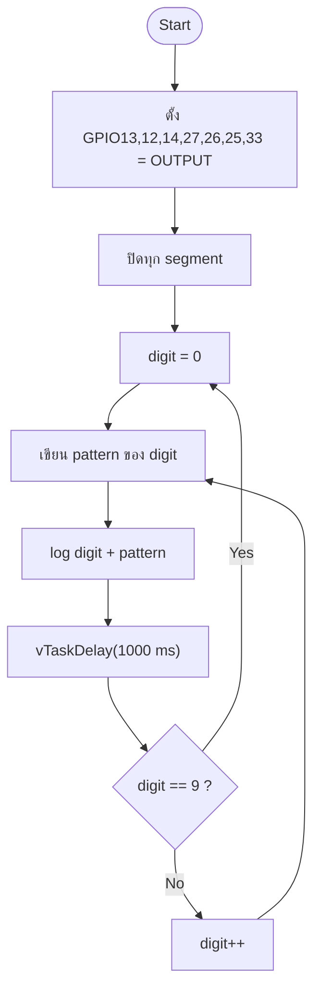

### ขั้นที่ 1 — กำหนดขา GPIO ของ segment

**ผังงาน**


**โค้ด**

```c
uint64_t output_mask = 0;
for (int i = 0; i < SEGMENT_COUNT; i++) {
    output_mask |= 1ULL << s_segment_pins[i];
}
const gpio_config_t io_config = {
    .pin_bit_mask = output_mask,
    .mode = GPIO_MODE_OUTPUT,
    .pull_up_en = GPIO_PULLUP_DISABLE,
    .pull_down_en = GPIO_PULLDOWN_DISABLE,
    .intr_type = GPIO_INTR_DISABLE,
};
ESP_ERROR_CHECK(gpio_config(&io_config));
```

**ผลการทดลอง**

- `gpio_config()` สำเร็จ ไม่มี error ทาง Serial
- ขาทั้ง 7 เป็น output และเริ่มที่ระดับ LOW → display ดับทุก segment
- ระดับลอจิกของขา GPIO เป็น LOW (0) ในสถานะดับ และ HIGH (1) ในสถานะติด

### ขั้นที่ 2 — แปลงเลขเป็น pattern

**ผังงาน**

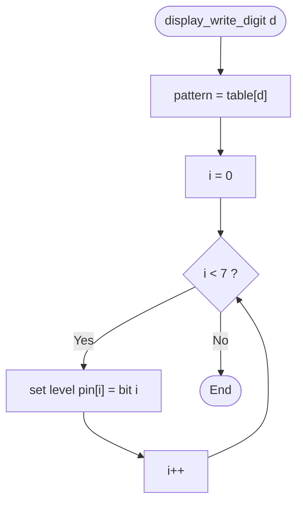

**โค้ด**

```c
static const uint8_t s_digit_patterns[10] = {
    0x3F, 0x06, 0x5B, 0x4F, 0x66,
    0x6D, 0x7D, 0x07, 0x7F, 0x6F,
};

static void display_write_digit(uint8_t digit)
{
    const uint8_t pattern = s_digit_patterns[digit % 10U];
    for (int i = 0; i < SEGMENT_COUNT; i++) {
        gpio_set_level(s_segment_pins[i], (pattern >> i) & 0x01U);
    }
}
```

**ผลการทดลอง**

| เลข | Pattern | หน้าจอ |
|---|---|---|
| 0 | `0x3F` | `0` |
| 1 | `0x06` | `1` |
| 2 | `0x5B` | `2` |
| 3 | `0x4F` | `3` |
| 4 | `0x66` | `4` |
| 5 | `0x6D` | `5` |
| 6 | `0x7D` | `6` |
| 7 | `0x07` | `7` |
| 8 | `0x7F` | `8` |
| 9 | `0x6F` | `9` |

ครบทั้ง 10 หลัก ไม่มี segment ผิดตำแหน่ง

### ขั้นที่ 3 — วนลำดับ 0–9

**ผังงาน**

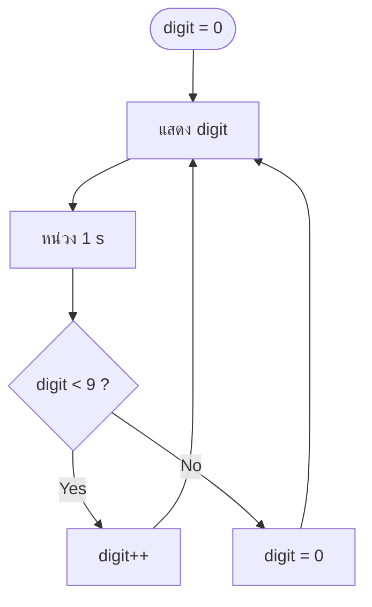

**ผลการทดลอง**

ลำดับบนจอ: `0 → 1 → 2 → 3 → 4 → 5 → 6 → 7 → 8 → 9 → 0 → …`
ต่อเนื่องไม่มีช่วงดับหรือข้ามเลข

### ขั้นที่ 4 — หน่วงเวลา 1 วินาที

**ผังงาน**


**ผลการทดลอง — Serial Monitor**

```text
I (312) TASK1: Task 1-4: auto counter 0-9, 1000 ms per digit
I (322) TASK1: digit=0 pattern=0x3F
I (1323) TASK1: digit=1 pattern=0x06
I (2324) TASK1: digit=2 pattern=0x5B
I (3324) TASK1: digit=3 pattern=0x4F
I (4325) TASK1: digit=4 pattern=0x66
I (5326) TASK1: digit=5 pattern=0x6D
I (6326) TASK1: digit=6 pattern=0x7D
I (7327) TASK1: digit=7 pattern=0x07
I (8328) TASK1: digit=8 pattern=0x7F
I (9328) TASK1: digit=9 pattern=0x6F
I (10329) TASK1: digit=0 pattern=0x3F
```

คาบเวลาระหว่าง log ≈ 1000 ms (tick 1 ms) ครบรอบ 10 หลักใช้เวลา ≈ 10 s

---

## 6.2 Task 5–8: การนับ 0–9 ด้วยสวิตช์

**ผังงานหลัก**

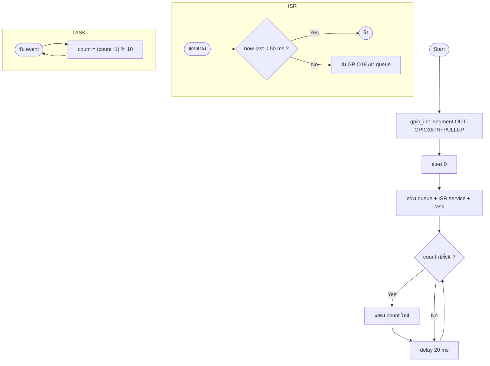

### ขั้นที่ 5 — ต่อสวิตช์และ pull-up

**ผังงาน**

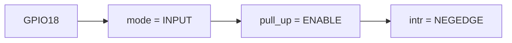

**ผลการทดลอง**

- ไม่กด: GPIO18 = 3.3 V (HIGH)
- กด: GPIO18 = 0 V (LOW) และเกิด falling edge
- ใช้ pull-up ภายใน จึงไม่ต้องต่อตัวต้านทานภายนอก

### ขั้นที่ 6 — ISR และ debounce 50 ms

**ผังงาน**

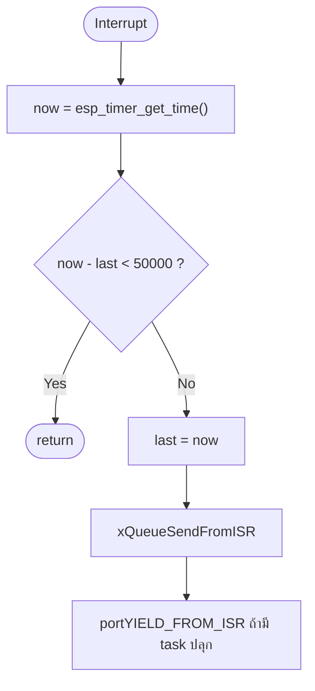

**โค้ด**

```c
static void IRAM_ATTR button_isr(void *arg)
{
    const int64_t now_us = esp_timer_get_time();
    if (now_us - s_last_isr_us < DEBOUNCE_US) {
        return;
    }
    s_last_isr_us = now_us;
    /* ... xQueueSendFromISR ... */
}
```

**ผลการทดลอง**

```
GPIO18  ‾‾‾|_|‾|_|‾|______________________
              ↑ ขอบแรกนับ
              |←──── 50 ms ────→|
              ขอบ bounce ถูกทิ้ง
```

กดหนึ่งครั้งได้หนึ่งค่า ไม่มีอาการนับซ้ำ

### ขั้นที่ 7 — นับแบบ modulo 10

**ผังงาน**


**ผลการทดลอง**

| กดครั้งที่ | 1 | 2 | … | 9 | 10 | 11 |
|---|---:|---:|---|---:|---:|---:|
| count | 1 | 2 | … | 9 | 0 | 1 |

### ขั้นที่ 8 — แสดงผลตามการกด

**ผลการทดลอง — Serial Monitor**

```text
I (318) TASK5: Task 5-8: press GPIO18 to count 0-9 (wraps at 9).
I (4210) TASK5: press on GPIO18 -> count=1
I (4222) TASK5: display=1
I (5104) TASK5: press on GPIO18 -> count=2
I (5116) TASK5: display=2
...
I (15820) TASK5: press on GPIO18 -> count=9
I (15831) TASK5: display=9
I (16902) TASK5: press on GPIO18 -> count=0
I (16914) TASK5: display=0
```

จอเปลี่ยนภายใน ≈ 20 ms หลังกด และวนกลับที่ 0 เมื่อครบ 10 ครั้ง

---

## 6.3 Task 9–12: ตัวนับสูงสุด 9 (Submission Check 1)

**ผังงานหลัก**

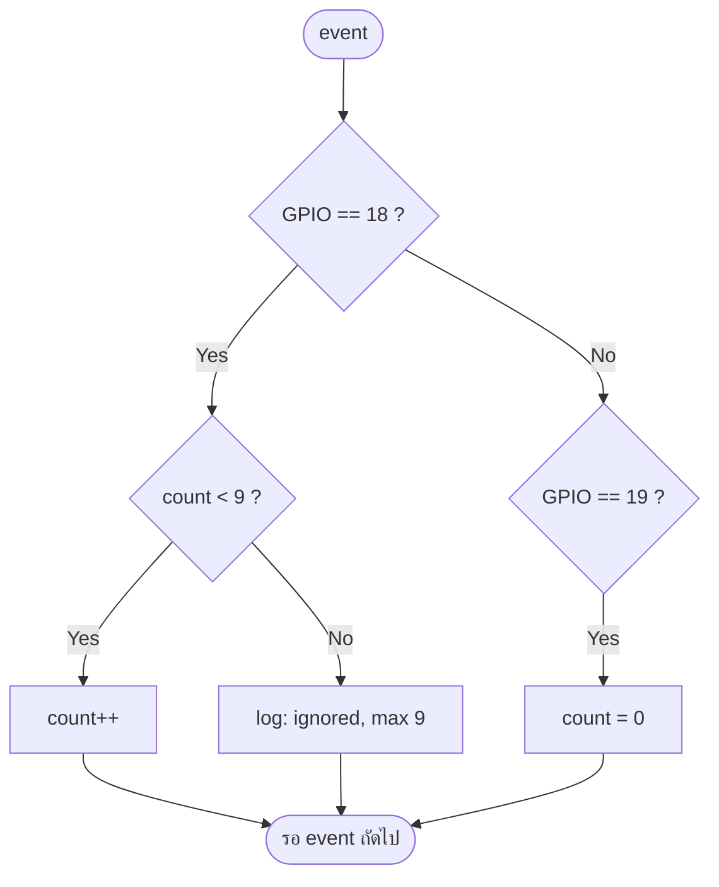

### ขั้นที่ 9 — กำหนดเพดาน MAX = 9

**โค้ด**

```c
#define MAX_COUNT           9
#define BUTTON_COUNT_GPIO   18
#define BUTTON_RESET_GPIO   19
```

**ผลการทดลอง**

- ตัวนับเริ่มที่ 0
- เพดานถูกใช้ทั้งในเงื่อนไขและข้อความ log ทำให้แก้ค่าได้จุดเดียว

### ขั้นที่ 10 — ตรรกะแบบอิ่มตัว

**ผังงาน**

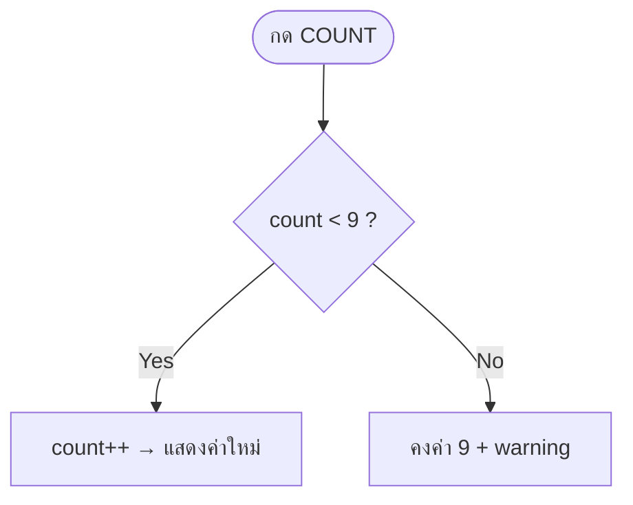

**ผลการทดลอง**

| กดครั้งที่ | 1–9 | 10 | 11 | 12 |
|---|---|---|---|---|
| count | 1–9 | 9 | 9 | 9 |
| หน้าจอ | 1–9 | 9 | 9 | 9 |

### ขั้นที่ 11 — ปุ่ม RESET

**ผลการทดลอง**

- กด RESET ขณะแสดง 9 → จอเปลี่ยนเป็น 0 ทันที
- หลัง reset นับใหม่ได้ตั้งแต่ 1 ถึง 9
- ใช้ ISR/queue/debounce ชุดเดียวกับปุ่ม COUNT โดยแยกด้วยหมายเลข GPIO

### ขั้นที่ 12 — ตรวจรับครั้งที่ 1

**ผลการทดลอง — Serial Monitor**

```text
I (320) TASK9: Task 9-12: press GPIO18 to count, max=9; GPIO19 resets.
I (2980) TASK9: COUNT press -> 1 (max 9)
I (3010) TASK9: display=1
...
I (12840) TASK9: COUNT press -> 9 (max 9)
I (12870) TASK9: display=9
I (13610) TASK9: COUNT press ignored: already at max 9
I (14330) TASK9: COUNT press ignored: already at max 9
I (15820) TASK9: RESET press -> count=0
I (15850) TASK9: display=0
```

| เกณฑ์ | ผล | สถานะ |
|---|---|---|
| เริ่มที่ 0 | แสดง 0 | ผ่าน |
| เพิ่มทีละ 1 | 1…9 | ผ่าน |
| ไม่เกิน 9 | ค้างที่ 9 | ผ่าน |
| กดเกินแล้วไม่วนกลับ | warning + คงค่า | ผ่าน |
| RESET กลับ 0 | ทำงาน | ผ่าน |
| ไม่มี bounce | 50 ms debounce | ผ่าน |

**สรุปการตรวจรับครั้งที่ 1: ผ่าน**

---

## 6.4 Task 13: แสดง `88` บนสองหลักพร้อมกัน

**ผังงาน**

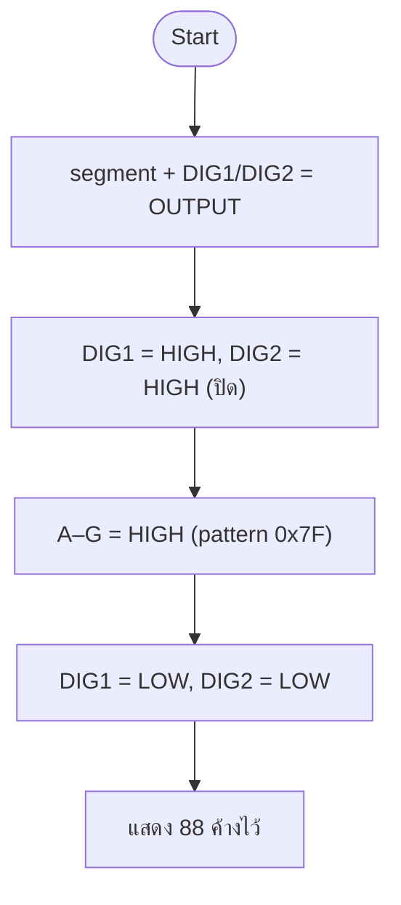

**โค้ด**

```c
static void display_show_88(void)
{
    gpio_set_level(DIGIT_TENS_GPIO, 1);
    gpio_set_level(DIGIT_UNITS_GPIO, 1);

    for (int i = 0; i < SEGMENT_COUNT; i++) {
        gpio_set_level(s_segment_pins[i], (PATTERN_8 >> i) & 0x01U);
    }

    gpio_set_level(DIGIT_TENS_GPIO, 0);
    gpio_set_level(DIGIT_UNITS_GPIO, 0);
}
```

**ผลการทดลอง**

```text
  _       _
 |_|     |_|
 |_|  .  |_|
```

```text
I (312) TASK13: Task 13: static drive, DIG1=GPIO16 and DIG2=GPIO17 both ON
I (313) TASK13: Task 13: pattern=0x7F -> display shows 88
```

- ทั้งสองหลักติดพร้อมกันและค้างนิ่ง
- DIG1/DIG2 เป็น LOW ตลอด; segment A–G เป็น HIGH ตลอด
- ไม่มี multiplex จึงไม่มี flicker
- ข้อควรระวังในฮาร์ดแวร์จริง: กระแสสองเท่า ควรใช้ทรานซิสเตอร์ขับ common

---

## 6.5 Task 14–17: ตัวนับ 00–99 ด้วยมัลติเพล็กซ์ (Submission Check 2)

**ผังงานหลัก**

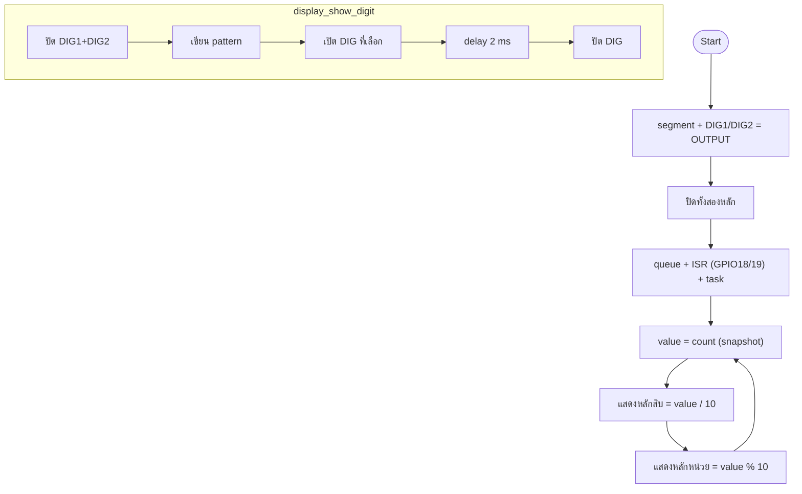

### ขั้นที่ 14 — ต่อวงจรมัลติเพล็กซ์

**ผังงาน**

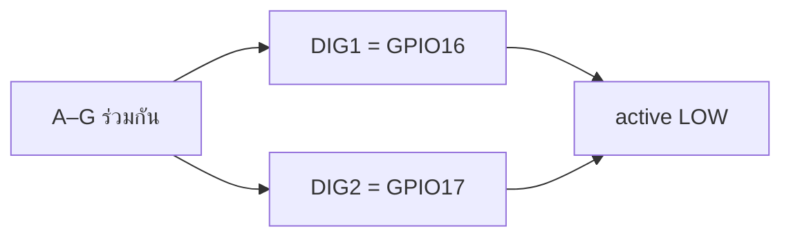

**ผลการทดลอง**

- ใช้ GPIO 9 ขา (7 segment + 2 common) แทน 14 ขาแบบ static
- เริ่มต้นปิดทุกหลักและทุก segment → จอว่าง
- ตรวจด้วยการเปิด DIG1 อย่างเดียว: เห็นเฉพาะหลักสิบ

### ขั้นที่ 15 — สลับหลักด้วยความถี่ 250 Hz

**ผังงาน**

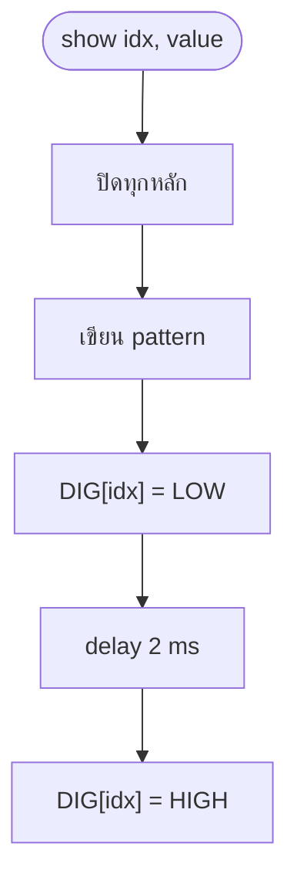

**ผลการทดลอง**

| พารามิเตอร์ | ค่า |
|---|---|
| เวลาต่อหลัก | 2 ms |
| จำนวนหลัก | 2 |
| คาบเต็มเฟรม | 4 ms |
| ความถี่รีเฟรช | 250 Hz |
| Duty cycle | 50 % ต่อหลัก |

```
DIG1  ‾‾‾‾|____|‾‾‾‾‾‾‾‾|____|‾‾‾‾
DIG2  ______|‾‾‾‾|____|‾‾‾‾|____
            2 ms  2 ms  2 ms
```

- ตามนุษย์มองเห็นเป็นสองหลักนิ่ง ไม่กระพริบ
- การปิดหลักก่อนเปลี่ยน segment ทำให้ไม่มี ghosting

### ขั้นที่ 16 — ตัวนับ 00–99

**ผังงาน**

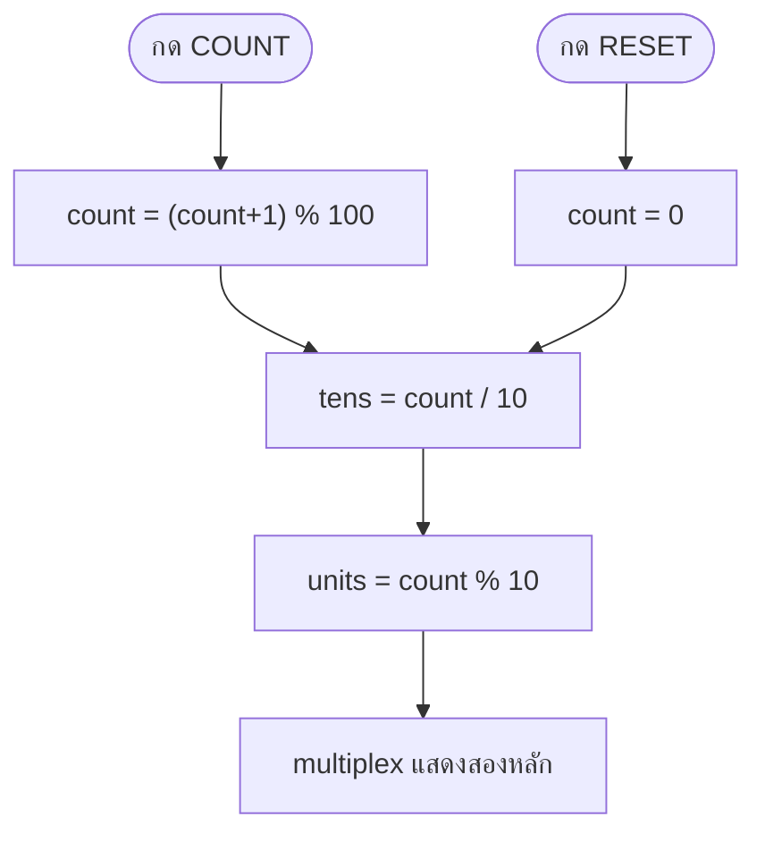

**ผลการทดลอง**

| count | tens | units | หน้าจอ |
|---:|---:|---:|---|
| 0 | 0 | 0 | `00` |
| 7 | 0 | 7 | `07` |
| 42 | 4 | 2 | `42` |
| 99 | 9 | 9 | `99` |
| 0 (หลัง 99) | 0 | 0 | `00` |

### ขั้นที่ 17 — ตรวจรับครั้งที่ 2

**ผลการทดลอง — Serial Monitor**

```text
I (321) TASK14: Task 14-17: press GPIO18 to count 00-99, GPIO19 resets.
I (322) TASK14: Multiplex: DIG1=GPIO16, DIG2=GPIO17, 2 ms per digit (~250 Hz).
I (3980) TASK14: COUNT press -> 01
I (4870) TASK14: COUNT press -> 02
...
I (42310) TASK14: COUNT press -> 42
...
I (98640) TASK14: COUNT press -> 99
I (99520) TASK14: COUNT press -> 00
I (100310) TASK14: RESET press -> 00
```

| เกณฑ์ | ผล | สถานะ |
|---|---|---|
| แสดงสองหลักพร้อมกัน | เห็น tens + units | ผ่าน |
| เริ่มที่ 00 | หน้าจอ 00 | ผ่าน |
| เพิ่มทีละ 1 | 01, 02, … | ผ่าน |
| ถึง 99 | แสดง 99 | ผ่าน |
| 99 → 00 | วนกลับถูกต้อง | ผ่าน |
| ไม่มี ghosting | ปิดหลักก่อนเปลี่ยน segment | ผ่าน |
| ไม่กระพริบ | 250 Hz | ผ่าน |
| RESET กลับ 00 | ทำงาน | ผ่าน |

**สรุปการตรวจรับครั้งที่ 2: ผ่าน**

---

## 7. สรุปผลการทดลอง

| Task | หัวข้อ | ผลลัพธ์ | สถานะ |
|---|---|---|---|
| 1–4 | นับ 0–9 อัตโนมัติ | 0→9→0 ทุก 1 s | ผ่าน |
| 5–8 | นับด้วยสวิตช์ | กด 1 ครั้ง +1, 9→0 | ผ่าน |
| 9–12 | นับสูงสุด 9 (Check 1) | อิ่มตัวที่ 9, reset ได้ | ผ่าน |
| 13 | แสดง 88 สองหลัก | นิ่ง ไม่กระพริบ | ผ่าน |
| 14–17 | นับ 00–99 (Check 2) | 00→99→00, multiplex 250 Hz | ผ่าน |

ข้อสรุปเชิงเทคนิค:

1. Common Cathode ขับด้วยลอจิก HIGH ที่ segment และ LOW ที่ common
2. ตาราง pattern แยกข้อมูลออกจากตรรกะ ทำให้โค้ดสั้นและตรวจสอบง่าย
3. FreeRTOS queue + ISR debounce เป็นรูปแบบที่ปลอดภัยสำหรับงาน GPIO
4. Saturating counter ต้องตรวจเพดานก่อนเพิ่มค่า
5. Multiplexing ลดจำนวน GPIO แต่ต้องแลกด้วย duty cycle 50 % และ timing ที่แม่นยำ
6. การปิดหลักก่อนเปลี่ยน segment เป็นเงื่อนไขจำเป็นในการป้องกัน ghosting

## 8. ปัญหาและแนวทางแก้ไข

| ปัญหา | สาเหตุ | แนวทางแก้ไข |
|---|---|---|
| Wokwi แจ้ง `firmware binary build/flasher_args.json not found` | ยังไม่ build หรือเปิด workspace ผิดระดับ | รัน `build_all.cmd` แล้วเปิดโฟลเดอร์โมดูลนั้นโดยตรง |
| `idf.py` ไม่รู้จัก | ยังไม่ activate ESP-IDF | ใช้ `build_all.cmd` ซึ่งตั้ง environment ให้ |
| PowerShell บล็อกสคริปต์ | Execution policy | เรียกผ่าน `build_all.cmd` ที่ใช้ `-ExecutionPolicy Bypass` |
| Display ไม่ติด | ต่อ COM ผิดหรือเลือก common ผิดชนิด | ใช้ `"common": "cathode"` และต่อ COM ลง GND |
| ตัวเลขเพี้ยน | สลับขา A–G | ตรวจ `s_segment_pins[]` กับ `diagram.json` |
| กดครั้งเดียวนับหลายครั้ง | Bounce | คงเวลา debounce 50 ms |
| จอสองหลักกระพริบ | Refresh ช้า | ลดเวลาต่อหลักเหลือ 2 ms (250 Hz) |
| เห็นเลขซ้อน | ไม่ปิดหลักก่อนเปลี่ยน segment | เรียก `display_digits_off()` ก่อนเขียน pattern |
| ตัวเลขกระโดดข้าม | ปุ่ม bounce หรือ count เปลี่ยนกลางเฟรม | debounce + อ่าน snapshot ครั้งเดียว |

## 9. ภาคผนวก

### 9.1 โครงสร้างไฟล์

```
Lab2/
├── .gitignore
├── README.md
├── LAB_REPORT.md
├── build_all.cmd
├── build_all.ps1
├── docs/
│   └── WIRING.md
├── task_1_to_4_auto_count_0_9/
│   ├── CMakeLists.txt
│   ├── sdkconfig.defaults
│   ├── wokwi.toml
│   ├── diagram.json
│   ├── REPORT.md
│   ├── build/
│   └── main/
│       ├── CMakeLists.txt
│       └── main.c
├── task_5_to_8_switch_count_0_9/      (โครงสร้างเดียวกัน)
├── task_9_to_12_press_counter_max_9/   (โครงสร้างเดียวกัน)
├── task_13_dual_segment_88/            (โครงสร้างเดียวกัน)
└── task_14_to_17_counter_00_99/        (โครงสร้างเดียวกัน)
```

### 9.2 คำสั่ง build ที่ใช้

```powershell
# ครั้งแรกของแต่ละโปรเจกต์
idf.py set-target esp32

# คอมไพล์และสร้างไฟล์สำหรับ Wokwi
idf.py build
```

หรือ build ทั้งห้าโปรเจกต์พร้อมกัน:

```powershell
cd C:\microcontrollerPJ\Lab2
.\build_all.cmd
```

### 9.3 ไฟล์ที่ Wokwi ต้องใช้ (ตรวจสอบแล้วมีครบทุกโมดูล)

| ไฟล์ | ขนาด | สถานะ |
|---|---:|---|
| `build/flasher_args.json` | — | มี |
| `build/bootloader/bootloader.bin` | 26,176 B | มี |
| `build/partition_table/partition-table.bin` | 3,072 B | มี |
| `build/<project>.bin` | 149–153 KB | มี |
| `build/<project>.elf` | ≈ 2.96 MB | มี |

| โมดูล | App bin (B) | Hex | ผล build |
|---|---:|---|---|
| `task_1_to_4_auto_count_0_9` | 149,408 | `0x247A0` | OK |
| `task_5_to_8_switch_count_0_9` | 152,688 | `0x25470` | OK |
| `task_9_to_12_press_counter_max_9` | 153,024 | `0x255C0` | OK |
| `task_13_dual_segment_88` | 149,424 | `0x247B0` | OK |
| `task_14_to_17_counter_00_99` | 153,120 | `0x25620` | OK |

### 9.4 การรันใน Wokwi

1. เปิดโฟลเดอร์โมดูลเดียวเป็น workspace
2. ตรวจว่า `build/flasher_args.json` มีอยู่
3. กด **Wokwi: Start Simulator**
4. เปิด Serial Monitor
5. ปุ่ม COUNT ใช้คีย์ `b`, ปุ่ม RESET ใช้คีย์ `r` (หรือคลิกที่ปุ่ม)

### 9.5 เอกสารรายละเอียดรายโมดูล

| Task | เอกสาร |
|---|---|
| 1–4 | [`task_1_to_4_auto_count_0_9/REPORT.md`](task_1_to_4_auto_count_0_9/REPORT.md) |
| 5–8 | [`task_5_to_8_switch_count_0_9/REPORT.md`](task_5_to_8_switch_count_0_9/REPORT.md) |
| 9–12 | [`task_9_to_12_press_counter_max_9/REPORT.md`](task_9_to_12_press_counter_max_9/REPORT.md) |
| 13 | [`task_13_dual_segment_88/REPORT.md`](task_13_dual_segment_88/REPORT.md) |
| 14–17 | [`task_14_to_17_counter_00_99/REPORT.md`](task_14_to_17_counter_00_99/REPORT.md) |
