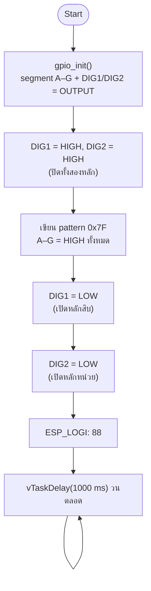

# รายงานการทดลอง Task 13
## การแสดงเลข 8 พร้อมกันบน Seven-Segment 2 หลัก

| รายการ | รายละเอียด |
|---|---|
| ชุดการทดลอง | Lab 2 — Seven Segment Display |
| ขั้นการทดลอง | 13 |
| โฟลเดอร์โครงการ | `task_13_dual_segment_88` |
| บอร์ด | ESP32 DevKit-C V4 (Wokwi) |
| เฟรมเวิร์ก | ESP-IDF v6.1 |
| ผลการ build | ผ่าน (`build/task_13_dual_segment_88.bin`, 149,424 B) |

---

## 1. วัตถุประสงค์

1. ต่อ Seven-Segment Display 2 หลัก (Common Cathode) เข้ากับ ESP32
2. เข้าใจว่า segment A–G ถูกใช้ร่วมกันทั้งสองหลัก และแยกด้วยขา DIG1/DIG2
3. ขับ DIG1 และ DIG2 พร้อมกันเพื่อแสดง `88` แบบ static drive
4. เตรียมความเข้าใจก่อนเข้าสู่การ multiplex ใน Task 14–17

## 2. อุปกรณ์

| ลำดับ | อุปกรณ์ | จำนวน |
|---|---|---|
| 1 | บอร์ด ESP32 DevKit-C V4 | 1 |
| 2 | Wokwi 7-Segment Display 2 หลัก (Common Cathode) | 1 |
| 3 | ตัวต้านทาน 220 Ω | 7 |
| 4 | สายต่อวงจร | ตามต้องการ |

## 3. การต่อวงจร

| ขา ESP32 | ขา Display | หน้าที่ |
|---|---|---|
| GPIO13 | A ผ่าน 220 Ω | segment A |
| GPIO12 | B ผ่าน 220 Ω | segment B |
| GPIO14 | C ผ่าน 220 Ω | segment C |
| GPIO27 | D ผ่าน 220 Ω | segment D |
| GPIO26 | E ผ่าน 220 Ω | segment E |
| GPIO25 | F ผ่าน 220 Ω | segment F |
| GPIO33 | G ผ่าน 220 Ω | segment G |
| GPIO16 | DIG1 | common หลักสิบ (active LOW) |
| GPIO17 | DIG2 | common หลักหน่วย (active LOW) |

ไม่มีขา COM เพราะเป็น display 2 หลัก ใช้ DIG1/DIG2 แทน

---

## 4. ผังงาน (Flowchart)



ลำดับที่ปลอดภัยคือ **ปิดหลัก → เปลี่ยน segment → เปิดหลัก** เพื่อป้องกัน
segment ค้าง (ghosting) จากค่าของเฟรมก่อนหน้า

---

## 5. บันทึกโปรแกรม

ไฟล์ต้นฉบับ: [`main/main.c`](main/main.c)

| ฟังก์ชัน | หน้าที่ |
|---|---|
| `gpio_init()` | ตั้ง segment และ DIG ทั้งหมดเป็น output, เริ่มด้วยสถานะดับ |
| `display_show_88()` | ปิด DIG ทั้งคู่, เปิด A–G, แล้วเปิด DIG ทั้งคู่พร้อมกัน |
| `app_main()` | เรียกใช้ครั้งเดียวแล้ว idle |

โค้ดส่วนสำคัญ:

```c
#define DIGIT_TENS_GPIO   16
#define DIGIT_UNITS_GPIO  17
#define PATTERN_8         0x7F   /* A..G all on, common cathode */

static void display_show_88(void)
{
    /* Blank first: both common pins HIGH = off. */
    gpio_set_level(DIGIT_TENS_GPIO, 1);
    gpio_set_level(DIGIT_UNITS_GPIO, 1);

    /* All seven segments on. */
    for (int i = 0; i < SEGMENT_COUNT; i++) {
        gpio_set_level(s_segment_pins[i], (PATTERN_8 >> i) & 0x01U);
    }

    /* Enable both digits at the same time. */
    gpio_set_level(DIGIT_TENS_GPIO, 0);
    gpio_set_level(DIGIT_UNITS_GPIO, 0);
}
```

---

## 6. บันทึกผลการทดลอง

**ผลลัพธ์บนหน้าจอ**

```text
  _       _
 |_|     |_|
 |_|  .  |_|
```

ทั้งสองหลักแสดงเลข 8 พร้อมกันและค้างอยู่ตลอด ไม่กระพริบ

**ผลลัพธ์ทาง Serial Monitor**

```text
I (312) TASK13: Task 13: static drive, DIG1=GPIO16 and DIG2=GPIO17 both ON
I (313) TASK13: Task 13: pattern=0x7F -> display shows 88
```

**สัญญาณที่ขา Display (static drive)**

```
DIG1 (GPIO16)  ‾‾‾‾|________________________________|‾‾‾‾
DIG2 (GPIO17)  ‾‾‾‾|________________________________|‾‾‾‾
                   ←──── เปิดทั้งคู่ตลอดเวลา ────→
segment A–G    ____|‾‾‾‾‾‾‾‾‾‾‾‾‾‾‾‾‾‾‾‾‾‾‾‾‾‾‾‾‾‾‾‾|____
                        ทุก segment = HIGH
```

- DIG1 และ DIG2 เป็น LOW พร้อมกัน → ทั้งสองหลักมีเส้นทางครบวงจร
- Segment ทุกขาเป็น HIGH → LED ทุกดวงติด
- ไม่มีการสลับหลัก จึงไม่มีปัญหา flicker และไม่ต้องคำนวณ duty cycle
- เพราะทั้งสองหลักแสดงเลขเดียวกัน (8) การใช้ segment ร่วมกันจึงไม่เกิดภาพทับ

**ข้อสังเกตด้านกระแส**

ในวงจรจริง การเปิดสองหลักพร้อมกันทำให้กระแสที่ segment line เป็นสองเท่าของ
การแสดงหนึ่งหลัก และอาจเกินพิกัดของ GPIO หากไม่มีตัวต้านทานหรือ использовать
display ขนาดใหญ่ ใน Wokwi ไม่จำลองข้อจำกัดนี้ แต่ในการออกแบบจริงควรใช้
ทรานซิสเตอร์ขับ common หรือทำ multiplex

---

## 7. สรุปผล

- Display 2 หลักใช้ segment A–G ร่วมกันและเลือกหลักด้วย DIG1/DIG2
- การแสดงเลขเดียวกันทั้งสองหลักสามารถใช้ static drive ได้โดยไม่ต้อง multiplex
- การปิดหลักก่อนเปลี่ยน segment เป็นลำดับที่ถูกต้องและป้องกัน ghosting
- ผลการทดลองแสดง `88` พร้อมกันตามวัตถุประสงค์

## 8. ข้อสังเกตและปัญหา

| อาการ | สาเหตุ | วิธีแก้ |
|---|---|---|
| หลักใดหลักหนึ่งไม่ติด | DIG ขาไม่ถูกขับ LOW | ตรวจ GPIO16/17 และ `digits: "2"` |
| เห็นเลข 8 จาง ๆ ทั้งที่ปิด | ขาลอย (floating) | ตั้ง GPIO เป็น output ทุกขาและกำหนดสถานะเริ่มต้น |
| แสดงผลผิดหลัก | สลับ DIG1/DIG2 | ตรวจสาย GPIO16 → DIG1, GPIO17 → DIG2 |
| กระแสสูงเกินในฮาร์ดแวร์จริง | เปิดสองหลักพร้อมกัน | ใช้ multiplex หรือ transistor driver |
