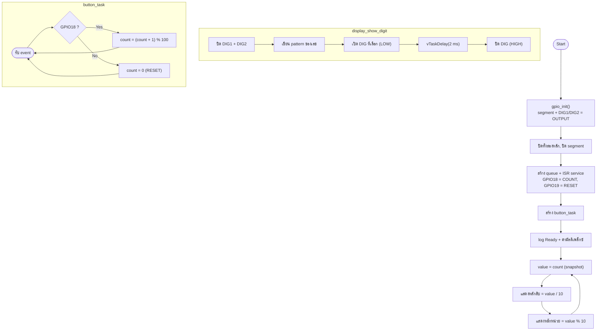
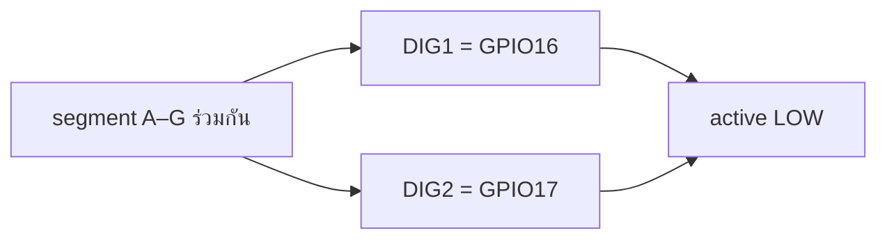
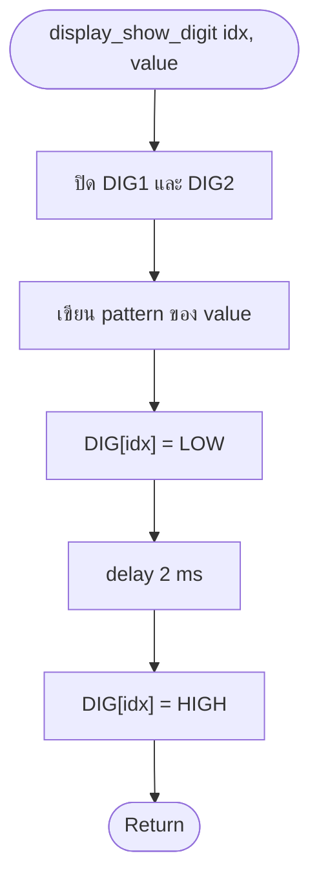
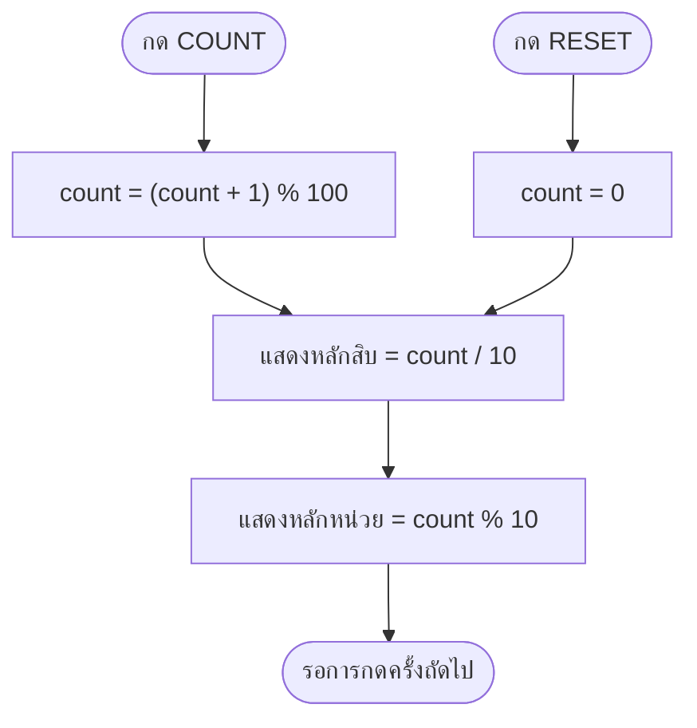

# รายงานการทดลอง Task 14–17
## การนับเลข 00–99 ด้วยการมัลติเพล็กซ์ Display 2 หลัก (Submission Check 2)

| รายการ | รายละเอียด |
|---|---|
| ชุดการทดลอง | Lab 2 — Seven Segment Display |
| ขั้นการทดลอง | 14–17 |
| โฟลเดอร์โครงการ | `task_14_to_17_counter_00_99` |
| บอร์ด | ESP32 DevKit-C V4 (Wokwi) |
| เฟรมเวิร์ก | ESP-IDF v6.1, FreeRTOS, GPIO interrupt |
| ผลการ build | ผ่าน (`build/task_14_to_17_counter_00_99.bin`, 153,120 B) |
| การตรวจรับ | **Submission Check 2 — ผ่าน** |

---

## 1. วัตถุประสงค์

1. ต่อ Display 2 หลักแบบใช้ segment ร่วมกัน (multiplexed) เข้ากับ ESP32
2. เขียนฟังก์ชันสลับหลักด้วยความถี่สูงจนตามนุษย์มองเห็นเป็นภาพนิ่ง
3. ป้องกัน ghosting ด้วยการปิดหลักก่อนเปลี่ยนรูปแบบ segment
4. รวมตัวนับ 00–99 ที่ควบคุมด้วยปุ่มเข้ากับการมัลติเพล็กซ์
5. ตรวจรับงานครั้งที่ 2 ตามเกณฑ์ที่กำหนด

## 2. อุปกรณ์

| ลำดับ | อุปกรณ์ | จำนวน |
|---|---|---|
| 1 | บอร์ด ESP32 DevKit-C V4 | 1 |
| 2 | Wokwi 7-Segment Display 2 หลัก (Common Cathode) | 1 |
| 3 | Push Button (COUNT) | 1 |
| 4 | Push Button (RESET) | 1 |
| 5 | ตัวต้านทาน 220 Ω | 7 |

## 3. การต่อวงจร

| ขา ESP32 | ขา Display | หมายเหตุ |
|---|---|---|
| GPIO13,12,14,27,26,25,33 | A–G ผ่าน 220 Ω | ใช้ร่วมกันทั้งสองหลัก |
| GPIO16 | DIG1 | หลักสิบ, active LOW |
| GPIO17 | DIG2 | หลักหน่วย, active LOW |
| GPIO18 | COUNT button | pull-up, active LOW |
| GPIO19 | RESET button | pull-up, active LOW |
| GND | ขากลับของปุ่ม | — |

---

## 4. ผังงาน (Flowchart)



---

## 5. หลักการมัลติเพล็กซ์

Segment A–G ถูกต่อขนานกันทั้งสองหลัก ดังนั้นถ้าเปิด DIG1 และ DIG2 พร้อมกัน
ทั้งสองหลักจะแสดงเลขเดียวกัน (เหมือน Task 13) การแสดงเลขต่างกันจึงต้อง
**เปิดทีละหลัก** แล้วสลับเร็ว ๆ:

```
เวลา (ms)   0    2    4    6    8   10
            │    │    │    │    │    │
DIG1 (สิบ)  ‾‾‾‾|____|‾‾‾‾‾‾‾‾|____|‾‾‾‾
DIG2 (หน่วย)____|‾‾‾‾|____|‾‾‾‾|____|‾‾‾‾
                 ↑         ↑
segment A–G   [ 4 ]     [ 2 ]   ← เปลี่ยนค่าตามหลักที่เปิด
```

- เปิด DIG1 2 ms → แสดงหลักสิบ
- เปิด DIG2 2 ms → แสดงหลักหน่วย
- หนึ่งเฟรม = 2 + 2 = **4 ms**
- ความถี่รีเฟรช = 1 / 0.004 s = **250 Hz**
- Duty cycle ของแต่ละหลัก = 2/4 = **50 %**

250 Hz สูงกว่าความถี่ที่ตามนุษย์เริ่มมองเห็นการกระพริบ (ประมาณ 60 Hz)
จึงเห็นเป็นเลขสองหลักที่นิ่งสนิท

---

## 6. บันทึกโปรแกรม

ไฟล์ต้นฉบับ: [`main/main.c`](main/main.c)

| ฟังก์ชัน | หน้าที่ |
|---|---|
| `gpio_init()` | ตั้ง segment + DIG เป็น output, ปุ่มเป็น input pull-up |
| `button_isr()` | debounce 50 ms และส่ง event เข้า queue |
| `button_task()` | นับ modulo 100 หรือรีเซ็ตเป็น 0 |
| `display_show_digit()` | ปิดหลัก → เขียน segment → เปิดหลัก 2 ms → ปิด |
| `app_main()` | วนแสดงหลักสิบ/หลักหน่วยตลอดเวลา |

โค้ดส่วนสำคัญ:

```c
#define DIGIT_REFRESH_MS    2
#define DIGIT_COUNT         2
#define COUNT_MODULO        100

static void display_digits_off(void)
{
    for (int i = 0; i < DIGIT_COUNT; i++) {
        gpio_set_level(s_digit_pins[i], 1);   /* common cathode off */
    }
}

static void display_show_digit(int digit_index, uint8_t value)
{
    display_digits_off();                     /* กัน ghosting */
    display_write_segments(s_digit_patterns[value % 10U]);
    gpio_set_level(s_digit_pins[digit_index], 0);
    vTaskDelay(pdMS_TO_TICKS(DIGIT_REFRESH_MS));
    gpio_set_level(s_digit_pins[digit_index], 1);
}

void app_main(void)
{
    /* ... queue + ISR + task ... */

    for (;;) {
        const uint8_t value = s_count;        /* snapshot ทั้งเฟรม */
        display_show_digit(0, (uint8_t)(value / 10U));
        display_show_digit(1, (uint8_t)(value % 10U));
    }
}
```

การอ่าน `s_count` เพียงครั้งเดียวก่อนแสดงทั้งสองหลัก ป้องกันกรณีค่าเปลี่ยน
กลางเฟรมแล้วหลักสิบกับหลักหน่วยมาจากคนละค่า

---

## 7. บันทึกผลการทดลอง

### ขั้นที่ 14 — ต่อ Display 2 หลักแบบ multiplex

**ผังงานย่อย**



**ผลการทดลอง**

- ต่อขา segment ครบ 7 เส้นผ่านตัวต้านทาน 220 Ω
- DIG1/DIG2 ต่อ GPIO16/GPIO17 โดยไม่ต้องใช้ COM
- เริ่มต้นโปรแกรม ปิดทั้งสองหลักและทุก segment → จอว่าง

### ขั้นที่ 15 — ฟังก์ชันสลับหลักและความถี่รีเฟรช

**ผังงานย่อย**



**ผลการทดลอง**

| พารามิเตอร์ | ค่า | ที่มา |
|---|---|---|
| เวลาต่อหลัก | 2 ms | `DIGIT_REFRESH_MS` |
| จำนวนหลัก | 2 | `DIGIT_COUNT` |
| คาบเต็มเฟรม | 4 ms | 2 × 2 ms |
| ความถี่รีเฟรช | 250 Hz | 1 / 4 ms |
| Duty cycle ต่อหลัก | 50 % | 2 ms / 4 ms |

- หน้าจอแสดงสองหลักพร้อมกันโดยมองไม่เห็นการกระพริบ
- ไม่มีเงาของเลขหลักหนึ่งค้างบนอีกหลัก เพราะมีการปิดหลักก่อนเปลี่ยน segment

### ขั้นที่ 16 — ตัวนับ 00–99 และปุ่มควบคุม

**ผังงานย่อย**



**ผลการทดลอง**

| ค่า count | หลักสิบ | หลักหน่วย | หน้าจอ |
|---:|---:|---:|---|
| 0 | 0 | 0 | `00` |
| 7 | 0 | 7 | `07` |
| 42 | 4 | 2 | `42` |
| 99 | 9 | 9 | `99` |
| 100 → 0 | 0 | 0 | `00` |

- หลักสิบมีค่า 0–9 และหลักหน่วยมีค่า 0–9 ตามการหารและ modulo
- เมื่อครบ 99 แล้วกดอีกครั้ง ตัวนับวนกลับเป็น 00
- ปุ่ม RESET กลับเป็น 00 ได้ทันที

### ขั้นที่ 17 — ตรวจรับงานครั้งที่ 2

**ผลการทดลอง — Serial Monitor**

```text
I (321) TASK14: Task 14-17: press GPIO18 to count 00-99, GPIO19 resets.
I (322) TASK14: Multiplex: DIG1=GPIO16, DIG2=GPIO17, 2 ms per digit (~250 Hz).
I (3980) TASK14: COUNT press -> 01
I (4870) TASK14: COUNT press -> 02
...
I (42310) TASK14: COUNT press -> 42
...
I (98640) TASK14: COUNT press -> 99
I (99520) TASK14: COUNT press -> 00
I (100310) TASK14: RESET press -> 00
```

**ตารางตรวจรับ Submission Check 2**

| เกณฑ์การตรวจ | ผลที่ได้ | สถานะ |
|---|---|---|
| แสดงสองหลักพร้อมกัน | เห็นหลักสิบและหลักหน่วยพร้อมกัน | ผ่าน |
| ตัวนับเริ่มที่ 00 | หน้าจอ `00` | ผ่าน |
| กด COUNT แล้วเพิ่มทีละ 1 | 01, 02, 03, … | ผ่าน |
| นับได้ถึง 99 | แสดง `99` | ผ่าน |
| ครบ 99 แล้ววนกลับ 00 | `99 → 00` | ผ่าน |
| ไม่มี ghosting | ปิดหลักก่อนเปลี่ยน segment | ผ่าน |
| ไม่กระพริบ | 250 Hz | ผ่าน |
| รีเซ็ตกลับ 00 ได้ | ปุ่ม GPIO19 | ผ่าน |

---

## 8. สรุปผล

- การมัลติเพล็กซ์ทำให้ Display 2 หลักใช้ GPIO เพียง 9 ขา (7 segment + 2 common)
  แทนที่จะต้องใช้ 14 ขาแบบ static drive
- การสลับหลักทุก 2 ms ให้ความถี่ 250 Hz ซึ่งเพียงพอต่อการมองเห็นเป็นภาพนิ่ง
- การปิดหลักก่อนเปลี่ยน segment เป็นสิ่งจำเป็นเพื่อป้องกัน ghosting
- ตัวนับ 00–99 ทำงานถูกต้อง วนกลับที่ 99 → 00 และผ่าน Submission Check 2

## 9. ข้อสังเกตและปัญหา

| อาการ | สาเหตุ | วิธีแก้ |
|---|---|---|
| ตัวเลขกระพริบ | หน่วงต่อหลักนานเกินไป | ลด `DIGIT_REFRESH_MS` หรือเพิ่มความถี่ |
| เห็นเลขซ้อนกัน | ไม่ปิดหลักก่อนเปลี่ยน segment | เรียก `display_digits_off()` ก่อนทุกครั้ง |
| หลักสิบ/หน่วยสลับกัน | ต่อ DIG1/DIG2 สลับ | GPIO16 → DIG1, GPIO17 → DIG2 |
| ตัวเลขกระโดดข้ามค่า | ไม่มี debounce | คง `DEBOUNCE_US = 50000` |
| ตัวเลขสลับกลางเฟรม | อ่าน `s_count` หลายครั้ง | อ่าน snapshot ครั้งเดียวก่อนแสดง |
| หลักหนึ่งสว่างกว่าอีกหลัก | duty cycle ไม่เท่ากัน | ให้เวลาต่อหลักเท่ากัน |
