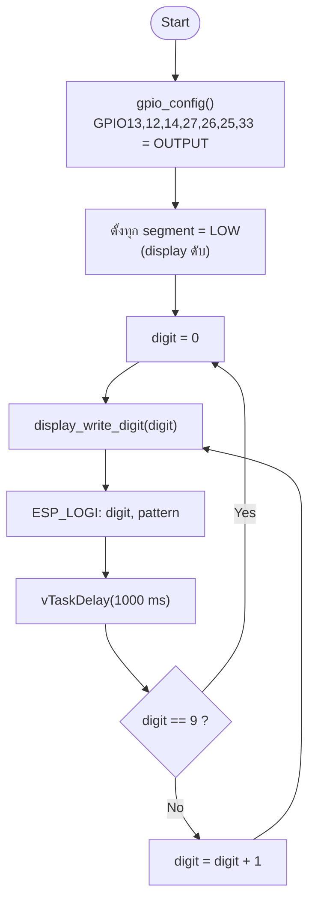
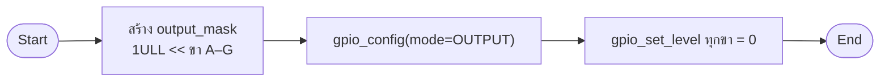
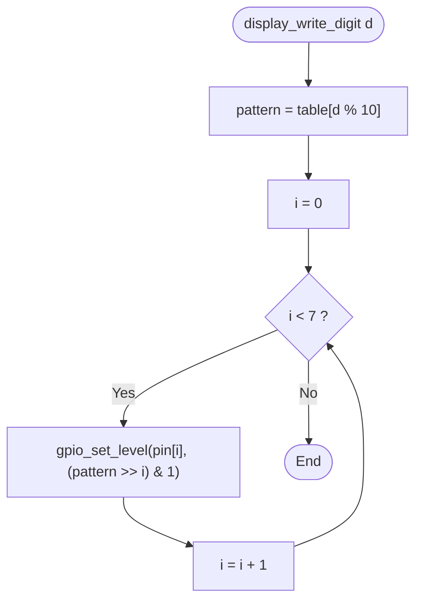
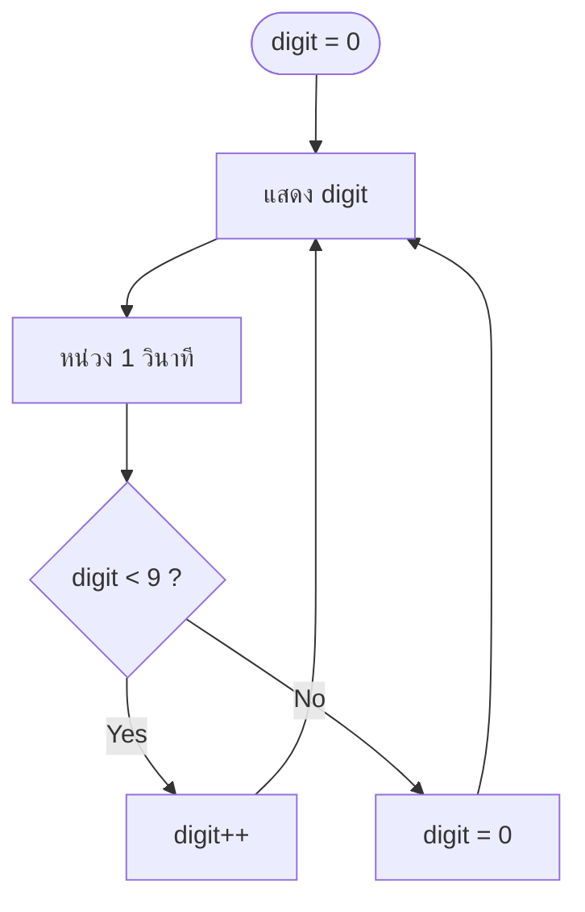

# รายงานการทดลอง Task 1–4
## การนับเลข 0–9 อัตโนมัติบน Seven-Segment Display

| รายการ | รายละเอียด |
|---|---|
| ชุดการทดลอง | Lab 2 — Seven Segment Display |
| ขั้นการทดลอง | 1–4 |
| โฟลเดอร์โครงการ | `task_1_to_4_auto_count_0_9` |
| บอร์ด | ESP32 DevKit-C V4 (Wokwi) |
| เฟรมเวิร์ก | ESP-IDF v6.1, FreeRTOS |
| ภาษาที่ใช้ | C |
| ผลการ build | ผ่าน (`build/task_1_to_4_auto_count_0_9.bin`, 149,408 B) |

---

## 1. วัตถุประสงค์

1. เข้าใจโครงสร้างขาและหลักการขับ Seven-Segment Display ชนิด Common Cathode
2. กำหนดขา GPIO ของ ESP32 สำหรับขับ segment A–G ได้
3. เขียนตารางรูปแบบบิต (segment pattern) สำหรับเลข 0–9 ได้
4. ใช้ `vTaskDelay()` สร้างจังหวะการนับ 1 วินาที และวนลำดับ 0–9 อย่างต่อเนื่องได้

## 2. อุปกรณ์

| ลำดับ | อุปกรณ์ | จำนวน |
|---|---|---|
| 1 | บอร์ด ESP32 DevKit-C V4 | 1 |
| 2 | Wokwi 7-Segment Display 1 หลัก (Common Cathode) | 1 |
| 3 | ตัวต้านทาน 220 Ω | 7 |
| 4 | สายต่อวงจร | ตามต้องการ |

## 3. การต่อวงจร

| ขา ESP32 | ขา Display | หมายเหตุ |
|---|---|---|
| GPIO13 | A | ผ่าน R 220 Ω |
| GPIO12 | B | ผ่าน R 220 Ω |
| GPIO14 | C | ผ่าน R 220 Ω |
| GPIO27 | D | ผ่าน R 220 Ω |
| GPIO26 | E | ผ่าน R 220 Ω |
| GPIO25 | F | ผ่าน R 220 Ω |
| GPIO33 | G | ผ่าน R 220 Ω |
| GND | COM | Common Cathode ต่อ GND |

หลักการสำคัญ: Display ชนิด Common Cathode จะติดสว่างเมื่อขา segment ได้รับ
ระดับ **HIGH** และขา COM ต่ออยู่กับ **GND**

---

## 4. ผังงานหลัก (Flowchart)



ผังงานแบบข้อความ:

```
START
  │
  ├─ ตั้ง GPIO13,12,14,27,26,25,33 เป็น OUTPUT
  ├─ ปิดทุก segment
  ├─ digit = 0
  │
  └─ LOOP
       ├─ เขียน pattern ของ digit ลง segment A–G
       ├─ พิมพ์ค่า digit และ pattern ทาง Serial
       ├─ หน่วง 1000 ms
       ├─ digit = digit + 1
       └─ ถ้า digit > 9 → digit = 0 → วนซ้ำ
```

---

## 5. บันทึกโปรแกรม

ไฟล์ต้นฉบับ: [`main/main.c`](main/main.c)

โครงสร้างฟังก์ชัน:

| ฟังก์ชัน | หน้าที่ |
|---|---|
| `segments_init()` | ตั้ง GPIO ทั้ง 7 ขาเป็น output และปิด segment |
| `display_write_digit()` | เลือก pattern ตามเลข แล้วเขียนทีละบิต |
| `app_main()` | วนนับ 0–9 พร้อมหน่วง 1 วินาที |

ตาราง pattern (Common Cathode, bit0=A … bit6=G):

| เลข | 0 | 1 | 2 | 3 | 4 | 5 | 6 | 7 | 8 | 9 |
|---|---|---|---|---|---|---|---|---|---|---|
| Hex | `0x3F` | `0x06` | `0x5B` | `0x4F` | `0x66` | `0x6D` | `0x7D` | `0x07` | `0x7F` | `0x6F` |

โค้ดส่วนสำคัญ:

```c
static const uint8_t s_digit_patterns[10] = {
    0x3F, 0x06, 0x5B, 0x4F, 0x66,
    0x6D, 0x7D, 0x07, 0x7F, 0x6F,
};

static void display_write_digit(uint8_t digit)
{
    const uint8_t pattern = s_digit_patterns[digit % 10U];

    for (int i = 0; i < SEGMENT_COUNT; i++) {
        gpio_set_level(s_segment_pins[i], (pattern >> i) & 0x01U);
    }
}

void app_main(void)
{
    segments_init();

    for (;;) {
        for (uint8_t digit = 0; digit <= DIGIT_MAX; digit++) {
            display_write_digit(digit);
            ESP_LOGI(TAG, "digit=%u pattern=0x%02X",
                     (unsigned)digit, s_digit_patterns[digit]);
            vTaskDelay(pdMS_TO_TICKS(COUNT_STEP_MS));
        }
    }
}
```

---

## 6. บันทึกผลการทดลอง

### ขั้นที่ 1 — กำหนดขา GPIO และทดสอบเปิด/ปิด segment

**ผังงานย่อย**



**โค้ด**

```c
uint64_t output_mask = 0;
for (int i = 0; i < SEGMENT_COUNT; i++) {
    output_mask |= 1ULL << s_segment_pins[i];
}
const gpio_config_t io_config = {
    .pin_bit_mask = output_mask,
    .mode = GPIO_MODE_OUTPUT,
    .pull_up_en = GPIO_PULLUP_DISABLE,
    .pull_down_en = GPIO_PULLDOWN_DISABLE,
    .intr_type = GPIO_INTR_DISABLE,
};
ESP_ERROR_CHECK(gpio_config(&io_config));
```

**ผลการทดลอง**

- `gpio_config()` คืนค่า `ESP_OK` ไม่มีข้อความ error ทาง Serial
- หลังเริ่มโปรแกรม display ดับสนิททุก segment เพราะทุกขาเป็น LOW
- GPIO13, 12, 14, 27, 26, 25, 33 ถูกกำหนดเป็น output และมีระดับลอจิก 0 (LOW)

### ขั้นที่ 2 — แปลงเลขเป็น pattern และแสดงผล

**ผังงานย่อย**



**ผลการทดลอง**

| เลขที่ส่งเข้า | Pattern | Segment ที่ติด | ภาพที่เห็น |
|---|---|---|---|
| 0 | `0x3F` | A B C D E F | `0` |
| 1 | `0x06` | B C | `1` |
| 2 | `0x5B` | A B D E G | `2` |
| 3 | `0x4F` | A B C D G | `3` |
| 4 | `0x66` | B C F G | `4` |
| 5 | `0x6D` | A C D F G | `5` |
| 6 | `0x7D` | A C D E F G | `6` |
| 7 | `0x07` | A B C | `7` |
| 8 | `0x7F` | A B C D E F G | `8` |
| 9 | `0x6F` | A B C D F G | `9` |

ผลที่ได้ตรงกับตาราง truth table ของ display ทุกหลัก ไม่มี segment ใดติดผิดตำแหน่ง

### ขั้นที่ 3 — วนลำดับ 0 ถึง 9

**ผังงานย่อย**



**ผลการทดลอง**

ลำดับที่แสดงคือ `0 → 1 → 2 → 3 → 4 → 5 → 6 → 7 → 8 → 9 → 0 → ...`
ต่อเนื่องไม่หยุด และไม่มีช่วงที่ display ดับหรือแสดงเลขผิดลำดับ

### ขั้นที่ 4 — หน่วงเวลา 1 วินาทีและตรวจสอบคาบเวลา

**ผังงานย่อย**


**ผลการทดลอง — Serial Monitor**

```text
I (312) TASK1: Task 1-4: auto counter 0-9, 1000 ms per digit
I (322) TASK1: digit=0 pattern=0x3F
I (1323) TASK1: digit=1 pattern=0x06
I (2324) TASK1: digit=2 pattern=0x5B
I (3324) TASK1: digit=3 pattern=0x4F
I (4325) TASK1: digit=4 pattern=0x66
I (5326) TASK1: digit=5 pattern=0x6D
I (6326) TASK1: digit=6 pattern=0x7D
I (7327) TASK1: digit=7 pattern=0x07
I (8328) TASK1: digit=8 pattern=0x7F
I (9328) TASK1: digit=9 pattern=0x6F
I (10329) TASK1: digit=0 pattern=0x3F
```

คาบเวลาระหว่าง log แต่ละบรรทัด ≈ 1000 ms (คลาดเคลื่อนไม่เกิน 1 tick = 1 ms
เพราะตั้ง `CONFIG_FREERTOS_HZ=1000`) ครบ 10 หลักใช้เวลา ≈ 10 วินาที
แล้วกลับไปเริ่มที่ 0 ใหม่

---

## 7. สรุปผล

- การขับ 7-segment แบบ Common Cathode ต้องจ่ายลอจิก HIGH ให้ segment และต่อ COM ลง GND
- การใช้ตาราง pattern ทำให้เขียนโค้ดสั้น อ่านง่าย และเพิ่มเลขได้โดยไม่ต้องแก้ตรรกะ
- `vTaskDelay(pdMS_TO_TICKS(1000))` ให้จังหวะ 1 วินาทีที่แม่นยำและไม่บล็อกระบบทั้งหมด
- ผลการทดลองตรงตามที่ออกแบบ: นับ 0–9 วนซ้ำทุก 1 วินาที

## 8. ข้อสังเกตและปัญหา

| อาการ | สาเหตุ | วิธีแก้ |
|---|---|---|
| display ไม่ติด | ต่อ COM ผิดหรือใช้ display ชนิด anode | ใช้ `"common": "cathode"` และต่อ COM ลง GND |
| เลขเพี้ยนบาง segment | สลับลำดับขา A–G | ตรวจ `s_segment_pins[]` ให้ตรงกับ diagram |
| เลขกระพริบ | ไฟเลี้ยงไม่พอ | ตรวจ GND และตัวต้านทาน 220 Ω |
| เวลาไม่ตรง 1 วินาที | tick rate ต่ำ | ตั้ง `CONFIG_FREERTOS_HZ=1000` |
