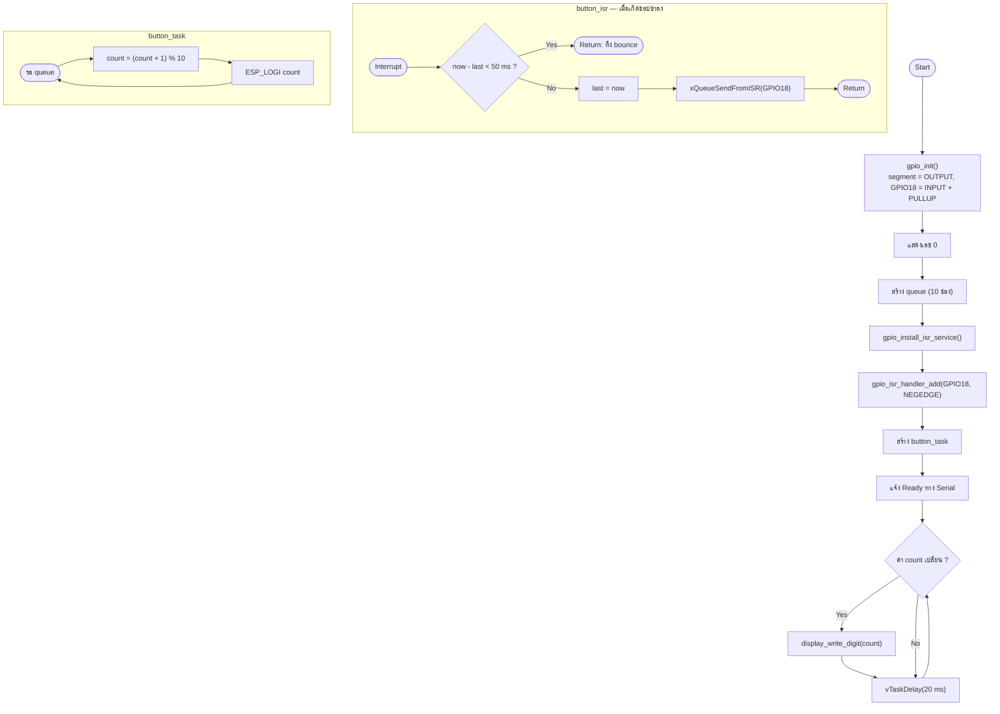
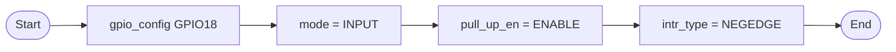
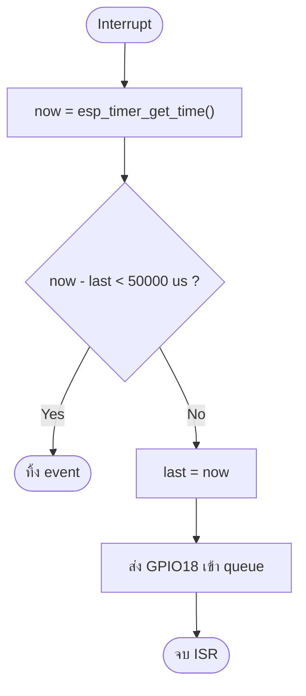
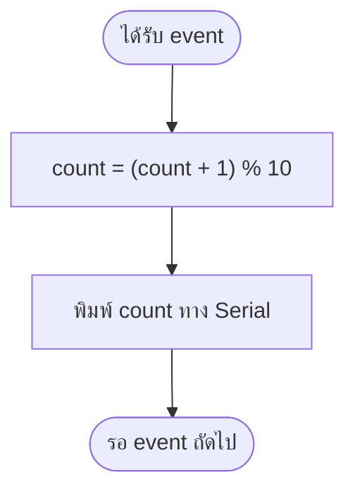

# รายงานการทดลอง Task 5–8
## การนับเลข 0–9 ด้วยสวิตช์กด (Switch-Controlled Counter)

| รายการ | รายละเอียด |
|---|---|
| ชุดการทดลอง | Lab 2 — Seven Segment Display |
| ขั้นการทดลอง | 5–8 |
| โฟลเดอร์โครงการ | `task_5_to_8_switch_count_0_9` |
| บอร์ด | ESP32 DevKit-C V4 (Wokwi) |
| เฟรมเวิร์ก | ESP-IDF v6.1, FreeRTOS, GPIO interrupt |
| ผลการ build | ผ่าน (`build/task_5_to_8_switch_count_0_9.bin`, 152,688 B) |

---

## 1. วัตถุประสงค์

1. ต่อ Push Button เข้ากับ GPIO18 แบบ internal pull-up และกำหนดให้ active LOW
2. ใช้ GPIO interrupt (falling edge) ตรวจจับการกดสวิตช์
3. กำจัด contact bounce ด้วยเวลาหน้าต่าง 50 ms ภายใน ISR
4. ส่งเหตุการณ์จาก ISR ไปยัง task ผ่าน FreeRTOS queue และนับ 0–9 แบบวนกลับ

## 2. อุปกรณ์

| ลำดับ | อุปกรณ์ | จำนวน |
|---|---|---|
| 1 | บอร์ด ESP32 DevKit-C V4 | 1 |
| 2 | Wokwi 7-Segment Display 1 หลัก (Common Cathode) | 1 |
| 3 | Push Button | 1 |
| 4 | ตัวต้านทาน 220 Ω | 7 |

## 3. การต่อวงจร

| ขา ESP32 | ต่อกับ | หมายเหตุ |
|---|---|---|
| GPIO13,12,14,27,26,25,33 | segment A–G ผ่าน 220 Ω | เหมือน Task 1–4 |
| GND | Display COM | Common Cathode |
| GPIO18 | Button ขา 1 | internal pull-up |
| GND | Button ขา 2 | กดแล้ว GPIO18 = LOW |

---

## 4. ผังงานหลัก (Flowchart)



---

## 5. บันทึกโปรแกรม

ไฟล์ต้นฉบับ: [`main/main.c`](main/main.c)

| ฟังก์ชัน | หน้าที่ |
|---|---|
| `gpio_init()` | ตั้ง segment เป็น output และ GPIO18 เป็น input pull-up + falling edge |
| `button_isr()` | debounce 50 ms แล้วส่งเลขขาเข้า queue (ISR สั้น) |
| `button_task()` | รับ event และเพิ่มค่า count แบบ modulo 10 |
| `display_write_digit()` | เขียน pattern ลง segment |
| `app_main()` | เริ่มระบบ แล้ววนแสดงค่าล่าสุดทุก 20 ms |

โค้ดส่วนสำคัญ:

```c
#define BUTTON_GPIO       18
#define DEBOUNCE_US       50000   /* 50 ms contact-bounce window */
#define DIGIT_MODULO      10

static void IRAM_ATTR button_isr(void *arg)
{
    const int64_t now_us = esp_timer_get_time();

    if (now_us - s_last_isr_us < DEBOUNCE_US) {
        return;                       /* อยู่ในหน้าต่าง bounce → ทิ้ง */
    }
    s_last_isr_us = now_us;

    const uint32_t gpio_num = (uint32_t)(uintptr_t)arg;
    BaseType_t high_priority_task_woken = pdFALSE;

    xQueueSendFromISR(s_button_queue, &gpio_num, &high_priority_task_woken);
    if (high_priority_task_woken == pdTRUE) {
        portYIELD_FROM_ISR();
    }
}

static void button_task(void *arg)
{
    for (;;) {
        uint32_t gpio_num = 0;
        if (xQueueReceive(s_button_queue, &gpio_num, portMAX_DELAY) == pdTRUE) {
            s_count = (uint8_t)((s_count + 1U) % DIGIT_MODULO);
            ESP_LOGI(TAG, "press on GPIO%u -> count=%u",
                     (unsigned)gpio_num, (unsigned)s_count);
        }
    }
}
```

### หลักการ debounce

```
สถานะปุ่ม (active LOW)
        กด
         │  bounce ~5–20 ms
         ▼
GPIO18  ‾‾‾|_|‾|_|‾|________________________
              ↑
         ขอบแรกถูกนับ
         │◄──── 50 ms ────►│
         ขอบที่เหลือในช่วงนี้ถูกทิ้ง

count   0 ────────────────────┬──────────────► 1
                              │ หลัง 50 ms
```

---

## 6. บันทึกผลการทดลอง

### ขั้นที่ 5 — ต่อสวิตช์และกำหนด pull-up

**ผังงานย่อย**



**ผลการทดลอง**

- ขณะไม่กด สวิตช์เปิดวงจร internal pull-up ดึง GPIO18 ขึ้น HIGH (3.3 V)
- ขณะกด สวิตช์ต่อ GPIO18 ลง GND → เกิดขอบขาลง (falling edge)

### ขั้นที่ 6 — ตรวจจับขอบขาลงและ debounce

**ผังงานย่อย**



**ผลการทดลอง**

- กดหนึ่งครั้งด้วยความเร็วปกติ ได้ `count` เพิ่มขึ้น 1 เสมอ
- กดค้างหรือกดเร็วมากภายใน 50 ms ไม่ทำให้ค่ากระโดด
- ไม่มี watchdog reset เพราะ ISR ทำงานสั้น (อ่านเวลา + ส่ง queue เท่านั้น)

### ขั้นที่ 7 — นับแบบ modulo 10

**ผังงานย่อย**



**ผลการทดลอง**

| จำนวนครั้งที่กด | ค่าที่แสดง |
|---:|---|
| 0 (เริ่มต้น) | 0 |
| 1 | 1 |
| 2 | 2 |
| … | … |
| 9 | 9 |
| 10 | 0 |
| 11 | 1 |

เมื่อถึง 9 แล้วกดอีกครั้งจะวนกลับไป 0 ตาม `% 10`

### ขั้นที่ 8 — แสดงผลและตรวจสอบ

**ผลการทดลอง — Serial Monitor**

```text
I (318) TASK5: Task 5-8: press GPIO18 to count 0-9 (wraps at 9).
I (4210) TASK5: press on GPIO18 -> count=1
I (4222) TASK5: display=1
I (5104) TASK5: press on GPIO18 -> count=2
I (5116) TASK5: display=2
I (6020) TASK5: press on GPIO18 -> count=3
I (6031) TASK5: display=3
...
I (15820) TASK5: press on GPIO18 -> count=9
I (15831) TASK5: display=9
I (16902) TASK5: press on GPIO18 -> count=0
I (16914) TASK5: display=0
```

การแสดงผลบนจอเปลี่ยนตามจำนวนครั้งที่กดทันที (ภายใน 20 ms ซึ่งเป็นคาบ
polling ของ `app_main`) และวนกลับที่ 0 เมื่อครบ 10 ครั้ง

---

## 7. สรุปผล

- การใช้ interrupt ตรวจจับปุ่มทำให้ไม่ต้อง polling และตอบสนองได้ทันที
- การ debounce ใน ISR ด้วยเวลาช่วยป้องกันการนับซ้ำจาก contact bounce
- FreeRTOS queue แยกงานหนักออกจาก ISR ตามแนวปฏิบัติที่ดีของ ESP-IDF
- ตัวนับ 0–9 ทำงานถูกต้องทั้งการเพิ่มค่าและการวนกลับ

## 8. ข้อสังเกตและปัญหา

| อาการ | สาเหตุ | วิธีแก้ |
|---|---|---|
| กดครั้งเดียวนับ 2–3 | ไม่มี debounce หรือ window สั้นเกิน | ใช้ `DEBOUNCE_US = 50000` |
| กดแล้วไม่นับ | ตั้ง `GPIO_INTR_POSEDGE` | ใช้ `GPIO_INTR_NEGEDGE` กับ active LOW |
| ค่าค้าง | ลืมสร้าง queue ก่อนติดตั้ง ISR | สร้าง queue ก่อน `gpio_install_isr_service()` |
| Serial ไม่ขึ้น | ไม่ได้ต่อ TX/RX กับ serial monitor | เก็บ connection `esp:TX → $serialMonitor:RX` |
