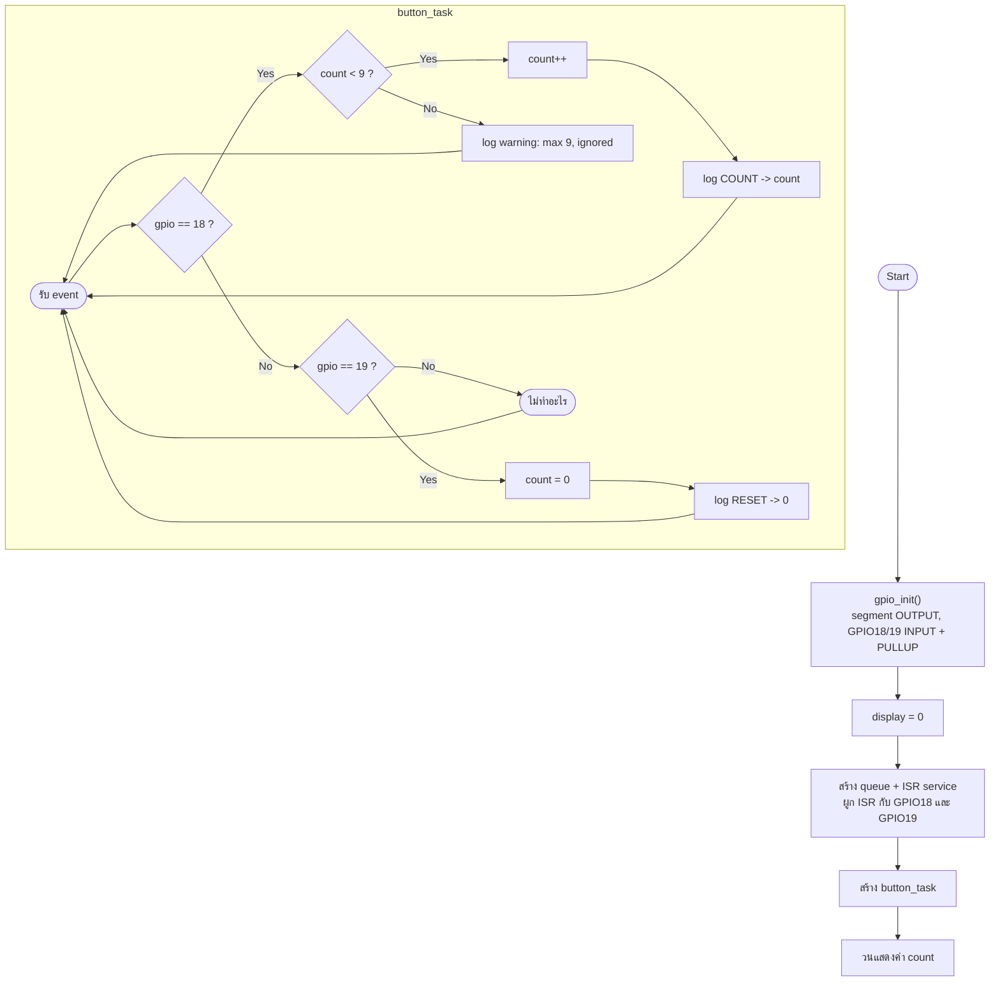
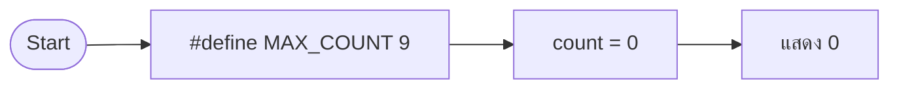
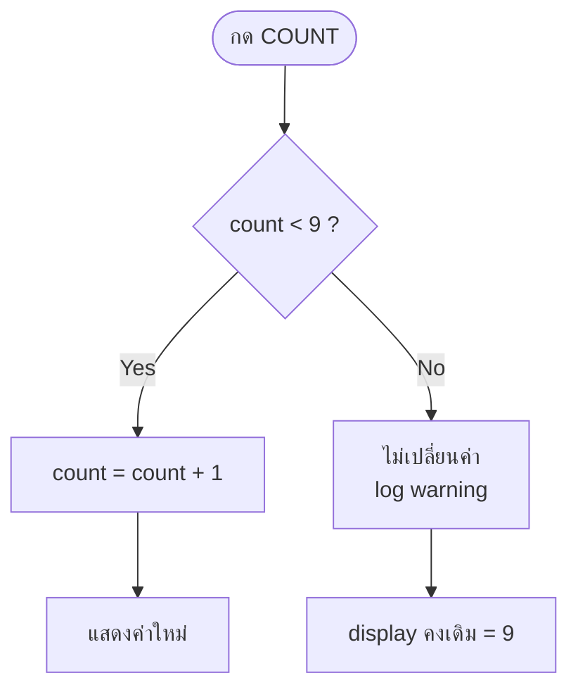

# รายงานการทดลอง Task 9–12
## การนับจำนวนครั้งการกดสวิตช์ สูงสุด 9 (Submission Check 1)

| รายการ | รายละเอียด |
|---|---|
| ชุดการทดลอง | Lab 2 — Seven Segment Display |
| ขั้นการทดลอง | 9–12 |
| โฟลเดอร์โครงการ | `task_9_to_12_press_counter_max_9` |
| บอร์ด | ESP32 DevKit-C V4 (Wokwi) |
| เฟรมเวิร์ก | ESP-IDF v6.1, FreeRTOS, GPIO interrupt |
| ผลการ build | ผ่าน (`build/task_9_to_12_press_counter_max_9.bin`, 153,024 B) |
| การตรวจรับ | **Submission Check 1 — ผ่าน** |

---

## 1. วัตถุประสงค์

1. กำหนดค่าสูงสุดของตัวนับ (`MAX_COUNT = 9`) และป้องกันไม่ให้แสดงเลขเกิน 9
2. เขียนตรรกะแบบอิ่มตัว (saturating counter) เมื่อถึง 9 ให้หยุดนับ
3. เพิ่มปุ่ม RESET (GPIO19) เพื่อกลับไปเริ่มที่ 0 โดยไม่ต้องรีบูต
4. ตรวจรับงานครั้งที่ 1 ตามเกณฑ์ที่กำหนด

## 2. อุปกรณ์

| ลำดับ | อุปกรณ์ | จำนวน |
|---|---|---|
| 1 | บอร์ด ESP32 DevKit-C V4 | 1 |
| 2 | Wokwi 7-Segment Display 1 หลัก (Common Cathode) | 1 |
| 3 | Push Button (COUNT) | 1 |
| 4 | Push Button (RESET) | 1 |
| 5 | ตัวต้านทาน 220 Ω | 7 |

## 3. การต่อวงจร

| ขา ESP32 | ต่อกับ | หมายเหตุ |
|---|---|---|
| GPIO13,12,14,27,26,25,33 | segment A–G ผ่าน 220 Ω | Common Cathode |
| GND | Display COM | — |
| GPIO18 | COUNT button | pull-up, active LOW, falling edge |
| GPIO19 | RESET button | pull-up, active LOW, falling edge |
| GND | ขากลับของปุ่มทั้งสอง | — |

---

## 4. ผังงานหลัก (Flowchart)



---

## 5. บันทึกโปรแกรม

ไฟล์ต้นฉบับ: [`main/main.c`](main/main.c)

| ฟังก์ชัน | หน้าที่ |
|---|---|
| `gpio_init()` | ตั้ง segment output, GPIO18/19 input pull-up + NEGEDGE |
| `button_isr()` | debounce 50 ms แล้วส่งเลขขาเข้า queue |
| `button_task()` | แยกว่าเป็น COUNT หรือ RESET และบังคับเพดานที่ 9 |
| `app_main()` | แสดงผลค่าล่าสุดทุก 20 ms |

โค้ดส่วนสำคัญ:

```c
#define BUTTON_COUNT_GPIO   18
#define BUTTON_RESET_GPIO   19
#define MAX_COUNT           9

static void button_task(void *arg)
{
    for (;;) {
        uint32_t gpio_num = 0;
        if (xQueueReceive(s_button_queue, &gpio_num, portMAX_DELAY) != pdTRUE) {
            continue;
        }

        if (gpio_num == BUTTON_COUNT_GPIO) {
            if (s_count < MAX_COUNT) {
                s_count++;
                ESP_LOGI(TAG, "COUNT press -> %u (max %d)",
                         (unsigned)s_count, MAX_COUNT);
            } else {
                ESP_LOGW(TAG, "COUNT press ignored: already at max %d", MAX_COUNT);
            }
        } else if (gpio_num == BUTTON_RESET_GPIO) {
            s_count = 0;
            ESP_LOGI(TAG, "RESET press -> count=0");
        }
    }
}
```

จุดสำคัญ: ตัวแปร `s_count` เป็น `uint8_t` และถูกแก้ไขใน task เดียว
ส่วน `app_main` อ่านค่าเพื่อแสดงผล ทำให้ไม่ต้องใช้ mutex สำหรับตัวเลข 1 ไบต์

---

## 6. บันทึกผลการทดลอง

### ขั้นที่ 9 — กำหนดค่าสูงสุด

**ผังงานย่อย**



**ผลการทดลอง**

- เริ่มต้นที่ `count = 0` และ display แสดง `0`
- ค่า `MAX_COUNT` ถูกใช้ทั้งในเงื่อนไขและข้อความ log ทำให้แก้เพดานได้ที่จุดเดียว

### ขั้นที่ 10 — ตรรกะนับแบบอิ่มตัว

**ผังงานย่อย**



**ผลการทดลอง**

| ครั้งที่กด | count | หน้าจอ | หมายเหตุ |
|---:|---:|---|---|
| 1–9 | 1–9 | 1–9 | เพิ่มครั้งละ 1 |
| 10 | 9 | 9 | ถูก ignore + warning |
| 11 | 9 | 9 | ถูก ignore |
| 12 | 9 | 9 | ถูก ignore |

ไม่มีกรณีที่หน้าจอแสดงค่ามากกว่า 9 หรือวนกลับเป็น 0 เอง

### ขั้นที่ 11 — ปุ่ม RESET และรายงานสถานะทาง Serial

**ผังงานย่อย**


**ผลการทดลอง**

- กด RESET ขณะแสดง 9 → หน้าจอเปลี่ยนเป็น 0 ทันที
- หลัง reset สามารถนับใหม่ได้ตั้งแต่ 1 ถึง 9
- ปุ่มทั้งสองใช้ ISR และ debounce ชุดเดียวกัน โดยแยกด้วยหมายเลข GPIO

### ขั้นที่ 12 — ตรวจรับงานครั้งที่ 1

**ผลการทดลอง — Serial Monitor**

```text
I (320) TASK9: Task 9-12: press GPIO18 to count, max=9; GPIO19 resets.
I (2980) TASK9: COUNT press -> 1 (max 9)
I (3010) TASK9: display=1
I (3920) TASK9: COUNT press -> 2 (max 9)
I (3950) TASK9: display=2
...
I (12840) TASK9: COUNT press -> 9 (max 9)
I (12870) TASK9: display=9
I (13610) TASK9: COUNT press ignored: already at max 9
I (14330) TASK9: COUNT press ignored: already at max 9
I (14990) TASK9: COUNT press ignored: already at max 9
I (15820) TASK9: RESET press -> count=0
I (15850) TASK9: display=0
```

**ตารางตรวจรับ Submission Check 1**

| เกณฑ์การตรวจ | ผลที่ได้ | สถานะ |
|---|---|---|
| เริ่มต้นแสดง 0 | แสดง `0` | ผ่าน |
| กด COUNT แล้วค่าบวกทีละ 1 | 1, 2, 3, … 9 | ผ่าน |
| ค่าสูงสุดไม่เกิน 9 | ค้างที่ 9 เมื่อกดเกิน | ผ่าน |
| กดเกิน 9 แล้วไม่วนกลับ | คงที่ 9 + warning | ผ่าน |
| รีเซ็ตกลับเป็น 0 ได้ | ปุ่ม GPIO19 ทำงาน | ผ่าน |
| ไม่มี bounce ทำให้ค่ากระโดด | 50 ms debounce | ผ่าน |

---

## 7. สรุปผล

- การทำ saturating counter ต้องตรวจเพดานก่อนเพิ่มค่า ไม่ใช่ปล่อยให้เกินแล้วค่อยตัด
- การแยกปุ่มด้วยหมายเลข GPIO ใน queue ทำให้ใช้ ISR ร่วมกันได้โดยไม่ต้องเขียนสองชุด
- ปุ่ม RESET ช่วยให้ตรวจรับซ้ำได้สะดวกและไม่ต้องรีบูตบอร์ด
- ผลการทดลองผ่านเกณฑ์ Submission Check 1 ทุกข้อ

## 8. ข้อสังเกตและปัญหา

| อาการ | สาเหตุ | วิธีแก้ |
|---|---|---|
| กดเกิน 9 แล้ววนเป็น 0 | ใช้ modulo แทนการอิ่มตัว | ตรวจ `if (count < MAX_COUNT)` ก่อนเพิ่ม |
| ปุ่ม RESET กดแล้วไม่ทำงาน | ไม่ได้ผูก ISR handler | เรียก `gpio_isr_handler_add(GPIO19, ...)` |
| กดปุ่มหนึ่งแล้วอีกปุ่มค้าง | ใช้ `s_last_isr_us` ร่วมกันแต่ทำงานถูกต้อง | คงไว้ได้ เพราะกัน bounce ทั้งสองปุ่มในหน้าต่างเดียว |
| ตัวเลขค้างที่ 9 ตลอด | ลืมต่อ RESET หรือใช้ GPIO ผิด | ตรวจสาย GPIO19 → GND |
